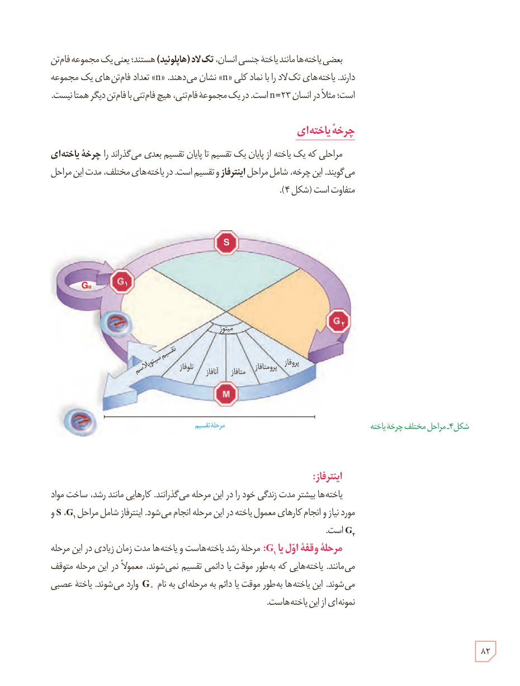

بعضی یاخته‌ها مانند یاختۀ جنسی انسان، تک‌لاد (هاپلوئید) هستند؛ یعنی یک مجموعه فام‌تن دارند. یاخته‌های تک‌لاد را با نماد کلی «n» نشان می‌دهند. «n» تعداد فام‌تن‌های یک مجموعه است؛ مثلاً در انسان n=۲۳ است. در یک مجموعه فام‌تنی، هیچ فام‌تنی با فام‌تن دیگر همتا نیست.

## چرخۀ یاخته‌ای

مراحلی که یک یاخته از پایان یک تقسیم تا پایان تقسیم بعدی می‌گذراند را چرخۀ یاخته‌ای می‌گویند. این چرخه، شامل مراحل اینترفاز و تقسیم است. در یاخته‌های مختلف، مدت این مراحل متفاوت است (شکل ۴).

شکل ۴ـ مراحل مختلف چرخۀ یاخته. برچسب‌ها: G₀، G₁، S، G₂، M، میتوز، پروفاز، پرومتافاز، متافاز، آنافاز، تلوفاز، تقسیم سیتوپلاسم، مرحلۀ تقسیم.

## اینترفاز

یاخته‌ها بیشتر مدت زندگی خود را در این مرحله می‌گذرانند. کارهایی مانند رشد، ساخت مواد مورد نیاز و انجام کارهای معمول یاخته در این مرحله انجام می‌شود. اینترفاز شامل مراحل G₁، S و G₂ است.

**مرحلۀ وقفۀ اول یا G₁:** مرحلۀ رشد یاخته‌هاست و یاخته‌ها مدت زمان زیادی در این مرحله می‌مانند. یاخته‌هایی که به‌طور موقت یا دائمی تقسیم نمی‌شوند، معمولاً در این مرحله متوقف می‌شوند. این یاخته‌ها به‌طور موقت یا دائم به مرحله‌ای به نام G₀ وارد می‌شوند. یاختۀ عصبی نمونه‌ای از این یاخته‌هاست.

۸۲

