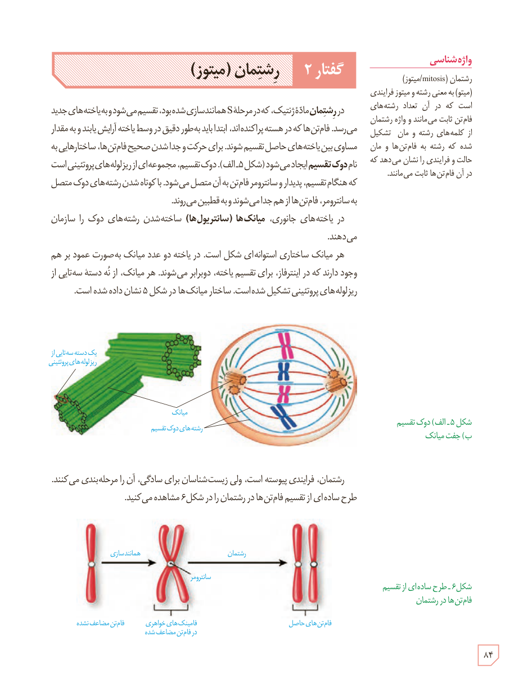

# گفتار ۲: رشتمان (میتوز)

در رشتمان، مادۀ ژنتیک، که در مرحلۀ S همانندسازی شده بود، تقسیم می‌شود و به یاخته‌های جدید می‌رسد. فام‌تن‌ها که در هسته پراکنده‌اند، ابتدا باید به‌طور دقیق در وسط یاخته آرایش یابند و به مقدار مساوی بین یاخته‌های حاصل تقسیم شوند. برای حرکت و جدا شدن صحیح فام‌تن‌ها، ساختارهایی به نام دوک تقسیم ایجاد می‌شود (شکل ۵ الف). دوک تقسیم، مجموعه‌ای از ریزلوله‌های پروتئینی است که هنگام تقسیم، پدیدار و سانترومر فام‌تن به آن متصل می‌شود. با کوتاه شدن رشته‌های دوک متصل به سانترومر، فام‌تن‌ها از هم جدا می‌شوند و به قطبین می‌روند.

در یاخته‌های جانوری، میانک‌ها (سانتریول‌ها) ساخته شدن رشته‌های دوک را سازمان می‌دهند.

هر میانک ساختاری استوانه‌ای شکل است. در یاخته دو عدد میانک به‌صورت عمود بر هم وجود دارند که در اینترفاز، برای تقسیم یاخته، دوبرابر می‌شوند. هر میانک، از نُه دستۀ سه‌تایی از ریزلوله‌های پروتئینی تشکیل شده است. ساختار میانک‌ها در شکل ۵ نشان داده شده است.

شکل ۵ـ الف) دوک تقسیم ب) جفت میانک. برچسب‌ها: یک دستۀ سه‌تایی از ریزلوله‌های پروتئینی، میانک، رشته‌های دوک تقسیم.

رشتمان، فرایندی پیوسته است، ولی زیست‌شناسان برای سادگی، آن را مرحله‌بندی می‌کنند. طرح ساده‌ای از تقسیم فام‌تن‌ها در رشتمان را در شکل ۶ مشاهده می‌کنید.

شکل ۶ـ طرح ساده‌ای از تقسیم فام‌تن‌ها در رشتمان. برچسب‌ها: فام‌تن مضاعف نشده، همانندسازی، سانترومر، فامینک‌های خواهری در فام‌تن مضاعف شده، رشتمان، فام‌تن‌های حاصل.

### واژه‌شناسی

رشتمان (mitosis/میتوز): (میتو) به معنی رشته و میتوز فرایندی است که در آن تعداد رشته‌های فام‌تن ثابت می‌مانند و واژۀ رشتمان از کلمه‌های رشته و مان تشکیل شده که رشته به فام‌تن‌ها و مان حالت و فرایندی را نشان می‌دهد که در آن فام‌تن‌ها ثابت می‌مانند.

۸۴

