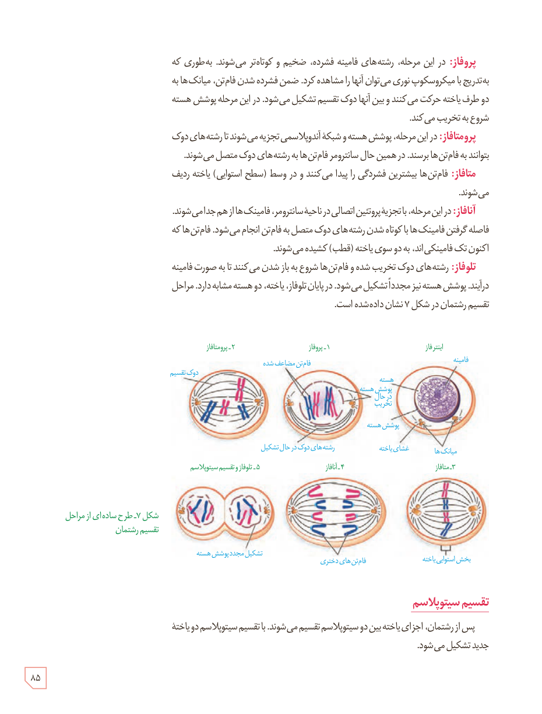

**پروفاز:** در این مرحله، رشته‌های فامینه فشرده، ضخیم و کوتاه‌تر می‌شوند. به‌طوری که به‌تدریج با میکروسکوپ نوری می‌توان آنها را مشاهده کرد. ضمن فشرده شدن فام‌تن، میانک‌ها به دو طرف یاخته حرکت می‌کنند و بین آنها دوک تقسیم تشکیل می‌شود. در این مرحله پوشش هسته شروع به تخریب می‌کند.

**پرومتافاز:** در این مرحله، پوشش هسته و شبکۀ آندوپلاسمی تجزیه می‌شوند تا رشته‌های دوک بتوانند به فام‌تن‌ها برسند. در همین حال سانترومر فام‌تن‌ها به رشته‌های دوک متصل می‌شوند.

**متافاز:** فام‌تن‌ها بیشترین فشردگی را پیدا می‌کنند و در وسط (سطح استوایی) یاخته ردیف می‌شوند.

**آنافاز:** در این مرحله، با تجزیۀ پروتئین اتصالی در ناحیۀ سانترومر، فامینک‌ها از هم جدا می‌شوند. فاصله گرفتن فامینک‌ها با کوتاه شدن رشته‌های دوک متصل به فام‌تن انجام می‌شود. فام‌تن‌ها که اکنون تک فامینکی‌اند، به دو سوی یاخته (قطب) کشیده می‌شوند.

**تلوفاز:** رشته‌های دوک تخریب شده و فام‌تن‌ها شروع به باز شدن می‌کنند تا به صورت فامینه درآیند. پوشش هسته نیز مجدداً تشکیل می‌شود. در پایان تلوفاز، یاخته، دو هستۀ مشابه دارد. مراحل تقسیم رشتمان در شکل ۷ نشان داده شده است.

شکل ۷ـ طرح ساده‌ای از مراحل تقسیم رشتمان. برچسب‌ها: اینترفاز، فامینه، هسته، پوشش هسته، غشای یاخته، میانک‌ها، ۱ـ پروفاز، فام‌تن مضاعف شده، پوشش هسته در حال تخریب، رشته‌های دوک در حال تشکیل، ۲ـ پرومتافاز، دوک تقسیم، ۳ـ متافاز، بخش استوایی یاخته، ۴ـ آنافاز، فام‌تن‌های دختری، ۵ـ تلوفاز و تقسیم سیتوپلاسم، تشکیل مجدد پوشش هسته.

## تقسیم سیتوپلاسم

پس از رشتمان، اجزای یاخته بین دو سیتوپلاسم تقسیم می‌شوند. با تقسیم سیتوپلاسم دو یاختۀ جدید تشکیل می‌شود.

۸۵

