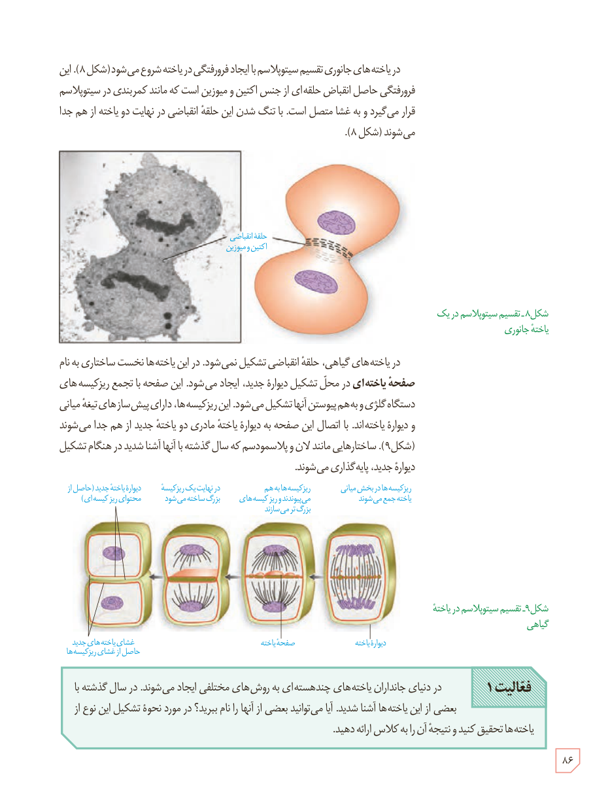

در یاخته‌های جانوری تقسیم سیتوپلاسم با ایجاد فرورفتگی در یاخته شروع می‌شود (شکل ۸). این فرورفتگی حاصل انقباض حلقه‌ای از جنس اکتین و میوزین است که مانند کمربندی در سیتوپلاسم قرار می‌گیرد و به غشا متصل است. با تنگ شدن این حلقۀ انقباضی در نهایت دو یاخته از هم جدا می‌شوند (شکل ۸).

شکل ۸ـ تقسیم سیتوپلاسم در یک یاختۀ جانوری. برچسب: حلقۀ انقباضی اکتین و میوزین.

در یاخته‌های گیاهی، حلقۀ انقباضی تشکیل نمی‌شود. در این یاخته‌ها نخست ساختاری به نام صفحۀ یاخته‌ای در محل تشکیل دیوارۀ جدید، ایجاد می‌شود. این صفحه با تجمع ریزکیسه‌های دستگاه گلژی و به هم پیوستن آنها تشکیل می‌شود. این ریزکیسه‌ها، دارای پیش‌سازهای تیغۀ میانی و دیوارۀ یاخته‌اند. با اتصال این صفحه به دیوارۀ یاختۀ مادری دو یاختۀ جدید از هم جدا می‌شوند (شکل ۹). ساختارهایی مانند لان و پلاسمودسم که سال گذشته با آنها آشنا شدید در هنگام تشکیل دیوارۀ جدید، پایه‌گذاری می‌شوند.

شکل ۹ـ تقسیم سیتوپلاسم در یاختۀ گیاهی. برچسب‌ها: ریزکیسه‌ها در بخش میانی یاخته جمع می‌شوند؛ ریزکیسه‌ها به هم می‌پیوندند و ریزکیسه‌های بزرگ‌تر می‌سازند؛ در نهایت یک ریزکیسۀ بزرگ ساخته می‌شود؛ دیوارۀ یاختۀ جدید (حاصل از محتوای ریزکیسه‌ها)؛ غشای یاخته‌های جدید حاصل از غشای ریزکیسه‌ها؛ صفحۀ یاخته؛ دیوارۀ یاخته.

**فعالیت ۱:** در دنیای جانداران یاخته‌های چندهسته‌ای به روش‌های مختلفی ایجاد می‌شوند. در سال گذشته با بعضی از این یاخته‌ها آشنا شدید. آیا می‌توانید بعضی از آنها را نام ببرید؟ در مورد نحوۀ تشکیل این نوع از یاخته‌ها تحقیق کنید و نتیجۀ آن را به کلاس ارائه دهید.

۸۶

