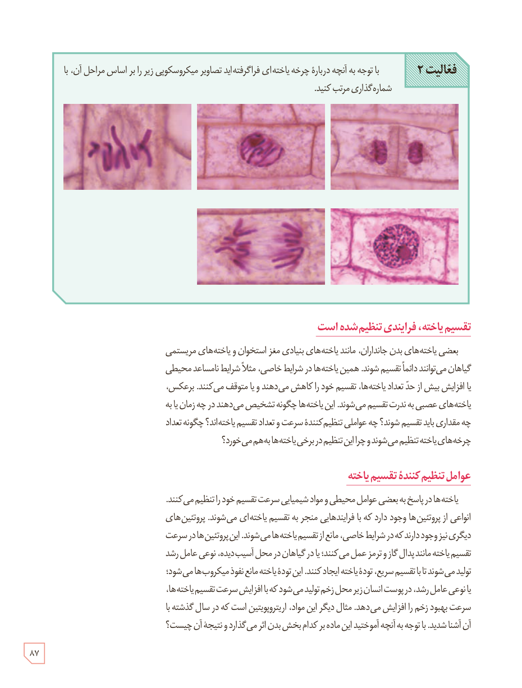

**فعالیت ۲:** با توجه به آنچه درباره چرخۀ یاخته‌ای فراگرفته‌اید تصاویر میکروسکوپی زیر را بر اساس مراحل آن، با شماره‌گذاری مرتب کنید.

## تقسیم یاخته، فرایندی تنظیم شده است

بعضی یاخته‌های بدن جانداران، مانند یاخته‌های بنیادی مغز استخوان و یاخته‌های مریستمی گیاهان می‌توانند دائماً تقسیم شوند. همین یاخته‌ها در شرایط خاصی، مثلاً شرایط نامساعد محیطی یا افزایش بیش از حد تعداد یاخته‌ها، تقسیم خود را کاهش می‌دهند و یا متوقف می‌کنند. برعکس، یاخته‌های عصبی به ندرت تقسیم می‌شوند. این یاخته‌ها چگونه تشخیص می‌دهند در چه زمان یا به چه مقداری باید تقسیم شوند؟ چه عواملی تنظیم‌کنندۀ سرعت و تعداد تقسیم یاخته‌اند؟ چگونه تعداد چرخه‌های یاخته تنظیم می‌شوند و چرا این تنظیم در برخی یاخته‌ها به‌هم می‌خورد؟

## عوامل تنظیم‌کنندۀ تقسیم یاخته

یاخته‌ها در پاسخ به بعضی عوامل محیطی و مواد شیمیایی سرعت تقسیم خود را تنظیم می‌کنند. انواعی از پروتئین‌ها وجود دارد که با فرایندهایی منجر به تقسیم یاخته‌ای می‌شوند. پروتئین‌های دیگری نیز وجود دارند که در شرایط خاصی، مانع از تقسیم یاخته‌ها می‌شوند. این پروتئین‌ها در سرعت تقسیم یاخته مانند پدال گاز و ترمز عمل می‌کنند؛ یا در گیاهان در محل آسیب‌دیده، نوعی عامل رشد تولید می‌شود تا با تقسیم سریع، تودۀ یاخته ایجاد کنند. این تودۀ یاخته مانع نفوذ میکروب‌ها می‌شود؛ یا نوعی عامل رشد، در پوست انسان زیر محل زخم تولید می‌شود که با افزایش سرعت تقسیم یاخته‌ها، سرعت بهبود زخم را افزایش می‌دهد. مثال دیگر این مواد، اریتروپویتین است که در سال گذشته با آن آشنا شدید. با توجه به آنچه آموختید این ماده بر کدام بخش بدن اثر می‌گذارد و نتیجۀ آن چیست؟

۸۷

