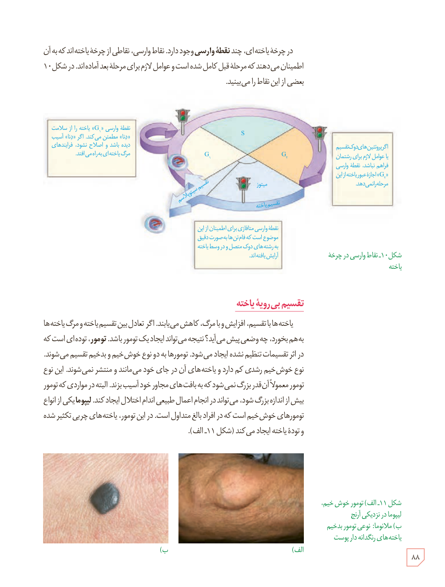

در چرخۀ یاخته‌ای، چند نقطۀ وارسی وجود دارد. نقاط وارسی، نقاطی از چرخۀ یاخته‌اند که به آن اطمینان می‌دهند که مرحلۀ قبل کامل شده است و عوامل لازم برای مرحلۀ بعد آماده‌اند. در شکل ۱۰ بعضی از این نقاط را می‌بینید.

شکل ۱۰ـ نقاط وارسی در چرخۀ یاخته. نقطۀ وارسی G₁ یاخته را از سلامت دنا مطمئن می‌کند. اگر دنا آسیب دیده باشد و اصلاح نشود، فرایندهای مرگ یاخته‌ای به راه می‌افتد. اگر پروتئین‌های دوک تقسیم یا عوامل لازم برای رشتمان فراهم نباشند، نقطۀ وارسی G₂ اجازۀ عبور یاخته از این مرحله را نمی‌دهد. نقطۀ وارسی متافازی برای اطمینان از این موضوع است که فام‌تن‌ها به صورت دقیق به رشته‌های دوک متصل و در وسط یاخته آرایش یافته‌اند.

## تقسیم بی‌رویۀ یاخته

یاخته‌ها با تقسیم، افزایش و با مرگ، کاهش می‌یابند. اگر تعادل بین تقسیم یاخته و مرگ یاخته‌ها به‌هم بخورد، چه وضعی پیش می‌آید؟ نتیجه می‌تواند ایجاد یک تومور باشد. تومور، توده‌ای است که در اثر تقسیمات تنظیم نشده ایجاد می‌شود. تومورها به دو نوع خوش‌خیم و بدخیم تقسیم می‌شوند. نوع خوش‌خیم رشدی کم دارد و یاخته‌های آن در جای خود می‌مانند و منتشر نمی‌شوند. این نوع تومور معمولاً آن‌قدر بزرگ نمی‌شود که به بافت‌های مجاور خود آسیب بزند. البته در مواردی که تومور بیش از اندازه بزرگ شود، می‌تواند در انجام اعمال طبیعی اندام اختلال ایجاد کند. لیپوما یکی از انواع تومورهای خوش‌خیم است که در افراد بالغ متداول است. در این تومور، یاخته‌های چربی تکثیر شده و تودۀ یاخته ایجاد می‌کنند (شکل ۱۱ـ الف).

شکل ۱۱ـ الف) تومور خوش‌خیم، لیپوما در نزدیکی آرنج ب) ملانوما: نوعی تومور بدخیم یاخته‌های رنگدانه‌دار پوست.

۸۸

