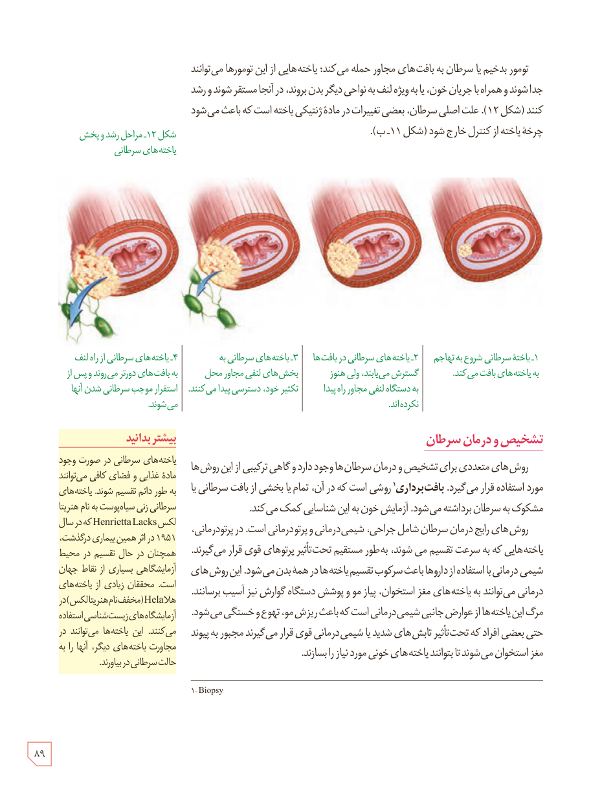

تومور بدخیم یا سرطان به بافت‌های مجاور حمله می‌کند؛ یاخته‌هایی از این تومورها می‌توانند جدا شوند و همراه با جریان خون، یا به‌ویژه لنف به نواحی دیگر بدن بروند، در آنجا مستقر شوند و رشد کنند (شکل ۱۲). علت اصلی سرطان، بعضی تغییرات در مادۀ ژنتیکی یاخته است که باعث می‌شود چرخۀ یاخته از کنترل خارج شود (شکل ۱۱ـ ب).

شکل ۱۲ـ مراحل رشد و پخش یاخته‌های سرطانی: ۱ـ یاختۀ سرطانی شروع به تهاجم به یاخته‌های بافت می‌کند. ۲ـ یاخته‌های سرطانی در بافت‌ها گسترش می‌یابند. ولی هنوز به دستگاه لنفی مجاور راه پیدا نکرده‌اند. ۳ـ یاخته‌های سرطانی به بخش‌های لنفی مجاور محل تکثیر خود، دسترسی پیدا می‌کنند. ۴ـ یاخته‌های سرطانی از راه لنف به بافت‌های دورتر می‌روند و پس از استقرار موجب سرطانی شدن آنها می‌شوند.

## تشخیص و درمان سرطان

روش‌های متعددی برای تشخیص و درمان سرطان‌ها وجود دارد و گاهی ترکیبی از این روش‌ها مورد استفاده قرار می‌گیرد. بافت‌برداری¹ روشی است که در آن، تمام یا بخشی از بافت سرطانی یا مشکوک به سرطان برداشته می‌شود. آزمایش خون به این شناسایی کمک می‌کند.

روش‌های رایج درمان سرطان شامل جراحی، شیمی‌درمانی و پرتودرمانی است. در پرتودرمانی، یاخته‌هایی که به سرعت تقسیم می‌شوند، به طور مستقیم تحت تأثیر پرتوهای قوی قرار می‌گیرند. شیمی‌درمانی با استفاده از داروها باعث سرکوب تقسیم یاخته‌ها در همۀ بدن می‌شود. این روش‌های درمانی می‌توانند به یاخته‌های مغز استخوان، پیاز مو و پوشش دستگاه گوارش نیز آسیب برسانند. مرگ این یاخته‌ها از عوارض جانبی شیمی‌درمانی است که باعث ریزش مو، تهوع و خستگی می‌شود. حتی بعضی افراد که تحت تأثیر تابش‌های شدید یا شیمی‌درمانی قوی قرار می‌گیرند مجبور به پیوند مغز استخوان می‌شوند تا بتوانند یاخته‌های خونی مورد نیاز را بسازند.

### بیشتر بدانید

یاخته‌های سرطانی در صورت وجود مادۀ غذایی و فضای کافی می‌توانند به طور دائم تقسیم شوند. یاخته‌های سرطانی زنی سیاه‌پوست به نام هنریتا لکس Henrietta Lacks که در سال ۱۹۵۱ در اثر همین بیماری درگذشت، همچنان در حال تقسیم در محیط آزمایشگاهی بسیاری از نقاط جهان است. محققان زیادی از یاخته‌های HeLa (مخفف نام هنریتا لکس) در آزمایشگاه‌های زیست‌شناسی استفاده می‌کنند. این یاخته‌ها می‌توانند در مجاورت یاخته‌های دیگر، آنها را به حالت سرطانی در بیاورند.

۱ـ Biopsy

۸۹

