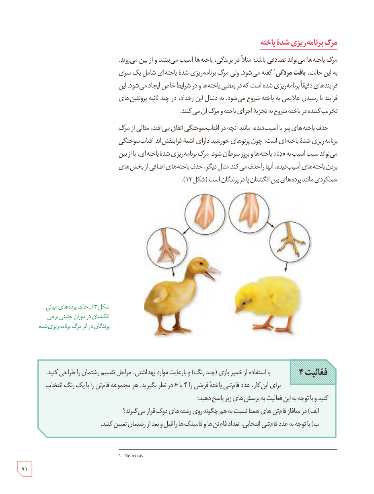

## مرگ برنامه‌ریزی شدۀ یاخته

مرگ یاخته‌ها می‌تواند تصادفی باشد؛ مثلاً در بریدگی، یاخته‌ها آسیب می‌بینند و از بین می‌روند. به این حالت، بافت‌مردگی¹ گفته می‌شود. ولی مرگ برنامه‌ریزی شدۀ یاخته‌ای شامل یک سری فرایندهای دقیقاً برنامه‌ریزی شده است که در بعضی یاخته‌ها و در شرایط خاص ایجاد می‌شود. این فرایند با رسیدن علائمی به یاخته شروع می‌شود. به دنبال این رخداد، در چند ثانیه پروتئین‌های تخریب‌کننده در یاخته شروع به تجزیۀ اجزای یاخته و مرگ آن می‌کنند.

حذف یاخته‌های پیر یا آسیب‌دیده، مانند آنچه در آفتاب‌سوختگی اتفاق می‌افتد، مثالی از مرگ برنامه‌ریزی شدۀ یاخته‌ای است؛ چون پرتوهای خورشید دارای اشعۀ فرابنفش‌اند. آفتاب‌سوختگی می‌تواند سبب آسیب به «دنا» یاخته‌ها و بروز سرطان شود. مرگ برنامه‌ریزی شدۀ یاخته‌ای، با از بین بردن یاخته‌های آسیب‌دیده، آنها را حذف می‌کند. مثال دیگر، حذف یاخته‌های اضافی از بخش‌های عملکردی مانند پرده‌های بین انگشتان پا در پرندگان است (شکل ۱۳).

شکل ۱۳ـ حذف پرده‌های میانی انگشتان در دوران جنینی برخی پرندگان در اثر مرگ برنامه‌ریزی شده.

**فعالیت ۴:** با استفاده از خمیر بازی (چند رنگ) و با رعایت موارد بهداشتی، مراحل تقسیم رشتمان را طراحی کنید. برای این کار، عدد فام‌تنی یاختۀ فرضی را ۴ یا ۶ در نظر بگیرید. هر مجموعۀ فام‌تن را با یک رنگ انتخاب کنید و با توجه به این فعالیت به پرسش‌های زیر پاسخ دهید:  
الف) در متافاز فام‌تن‌های همتا نسبت به هم چگونه روی رشته‌های دوک قرار می‌گیرند؟  
ب) با توجه به عدد فام‌تنی انتخابی، تعداد فام‌تن‌ها و فامینک‌ها را قبل و بعد از رشتمان تعیین کنید.

۱ـ Necrosis

۹۱

