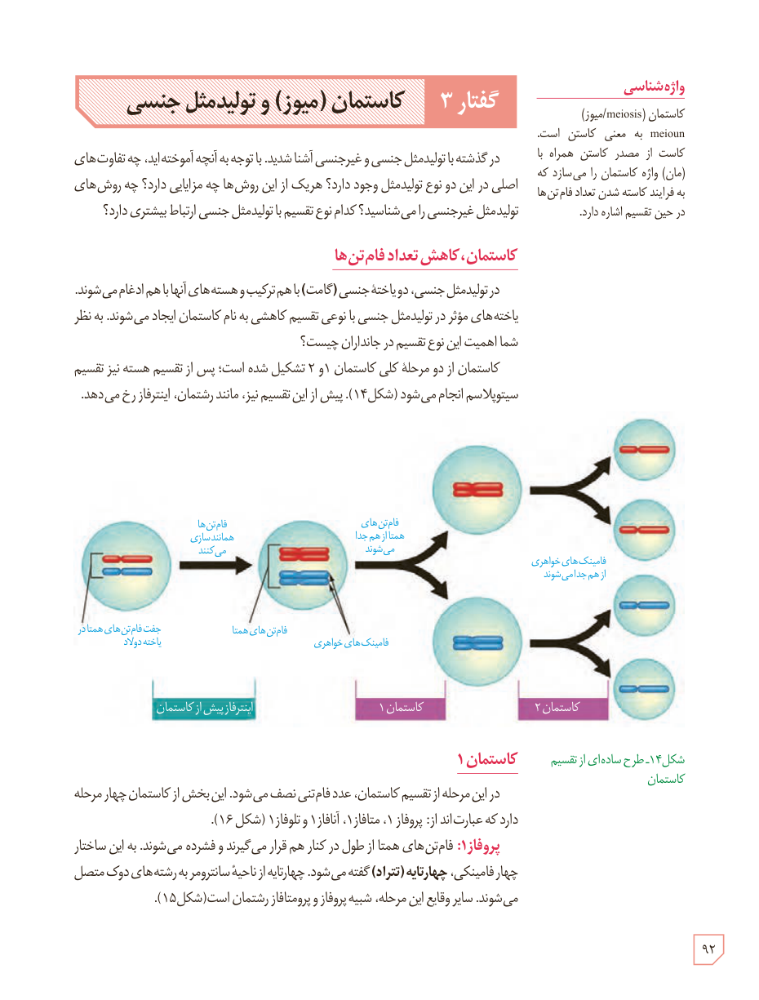

# گفتار ۳: کاستمان (میوز) و تولیدمثل جنسی

در گذشته با تولیدمثل جنسی و غیرجنسی آشنا شدید. با توجه به آنچه آموخته‌اید، چه تفاوت‌های اصلی در این دو نوع تولیدمثل وجود دارد؟ هر یک از این روش‌ها چه مزایایی دارند؟ چه روش‌های تولیدمثل غیرجنسی را می‌شناسید؟ کدام نوع تقسیم با تولیدمثل جنسی ارتباط بیشتری دارد؟

## کاستمان، کاهش تعداد فام‌تن‌ها

در تولیدمثل جنسی، دو یاختۀ جنسی (گامت) با هم ترکیب و هسته‌های آنها با هم ادغام می‌شوند. یاخته‌های مؤثر در تولیدمثل جنسی با نوعی تقسیم کاهشی به نام کاستمان ایجاد می‌شوند. به نظر شما اهمیت این نوع تقسیم در جانداران چیست؟

کاستمان از دو مرحلۀ کلی کاستمان ۱ و ۲ تشکیل شده است؛ پس از تقسیم هسته نیز تقسیم سیتوپلاسم انجام می‌شود (شکل ۱۴). پیش از این تقسیم نیز، مانند رشتمان، اینترفاز رخ می‌دهد.

شکل ۱۴ـ طرح ساده‌ای از تقسیم کاستمان. برچسب‌ها: جفت فام‌تن‌های همتا در یاختۀ دولاد، فام‌تن‌ها همانندسازی می‌کنند، فام‌تن‌های همتا، فامینک‌های خواهری، فام‌تن‌های همتا از هم جدا می‌شوند، فامینک‌های خواهری از هم جدا می‌شوند، اینترفاز پیش از کاستمان، کاستمان ۱، کاستمان ۲.

## کاستمان ۱

در این مرحله از تقسیم کاستمان، عدد فام‌تنی نصف می‌شود. این بخش از کاستمان چهار مرحله دارد که عبارت‌اند از: پروفاز ۱، متافاز ۱، آنافاز ۱ و تلوفاز ۱ (شکل ۱۶).

**پروفاز ۱:** فام‌تن‌های همتا از طول در کنار هم قرار می‌گیرند و فشرده می‌شوند. به این ساختار چهار فامینکی، چهارتایه (تتراد) گفته می‌شود. چهارتایه از ناحیۀ سانترومر به رشته‌های دوک متصل می‌شوند. سایر وقایع این مرحله، شبیه پروفاز و پرومتافاز رشتمان است (شکل ۱۵).

### واژه‌شناسی

کاستمان (meiosis/میوز): meioun به معنی کاستن است. کاست از مصدر کاستن همراه با (مان) واژۀ کاستمان را می‌سازد که به فرایند کاسته شدن تعداد فام‌تن‌ها در حین تقسیم اشاره دارد.

۹۲

