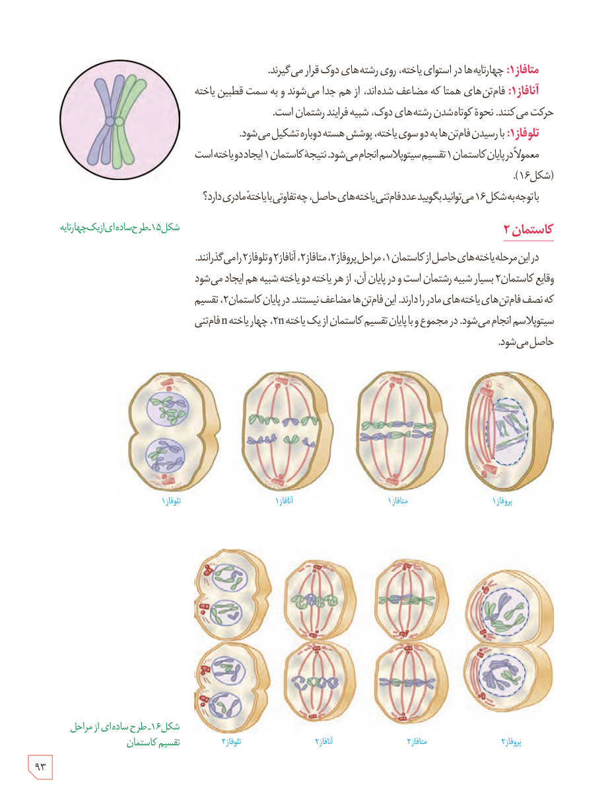

**متافاز ۱:** چهارتایه‌ها در استوای یاخته، روی رشته‌های دوک قرار می‌گیرند.

**آنافاز ۱:** فام‌تن‌های همتا که مضاعف شده‌اند، از هم جدا می‌شوند و به سمت قطبین یاخته حرکت می‌کنند. نحوۀ کوتاه‌شدن رشته‌های دوک، شبیه فرایند رشتمان است.

**تلوفاز ۱:** با رسیدن فام‌تن‌ها به دو سوی یاخته، پوشش هسته دوباره تشکیل می‌شود. معمولاً در پایان کاستمان ۱ تقسیم سیتوپلاسم انجام می‌شود. نتیجۀ کاستمان ۱ ایجاد دو یاخته است (شکل ۱۶).

با توجه به شکل ۱۶ می‌توانید بگویید عدد فام‌تنی یاخته‌های حاصل، چه تفاوتی با یاختۀ مادری دارد؟

شکل ۱۵ـ طرح ساده‌ای از یک چهارتایه.

## کاستمان ۲

در این مرحله یاخته‌های حاصل از کاستمان ۱، مراحل پروفاز ۲، متافاز ۲، آنافاز ۲ و تلوفاز ۲ را می‌گذرانند. وقایع کاستمان ۲ بسیار شبیه رشتمان است و در پایان آن، از هر یاخته دو یاختۀ شبیه هم ایجاد می‌شود که نصف فام‌تن‌های یاخته‌های مادر را دارند. این فام‌تن‌ها مضاعف نیستند. در پایان کاستمان ۲، تقسیم سیتوپلاسم انجام می‌شود. در مجموع و با پایان تقسیم کاستمان از یک یاختۀ 2n، چهار یاختۀ n فام‌تنی حاصل می‌شود.

شکل ۱۶ـ طرح ساده‌ای از مراحل تقسیم کاستمان: پروفاز ۱، متافاز ۱، آنافاز ۱، تلوفاز ۱، پروفاز ۲، متافاز ۲، آنافاز ۲، تلوفاز ۲.

۹۳

