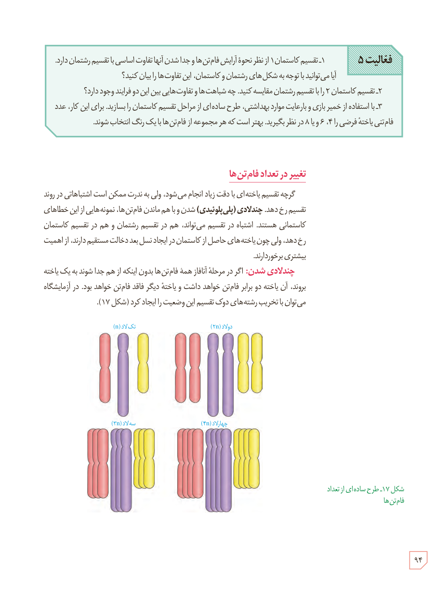

**فعالیت ۵:** ۱ـ تقسیم کاستمان ۱ از نظر نحوۀ آرایش فام‌تن‌ها و جدا شدن آنها تفاوت اساسی با تقسیم رشتمان دارد. آیا می‌توانید با توجه به شکل‌های رشتمان و کاستمان، این تفاوت‌ها را بیان کنید؟  
۲ـ تقسیم کاستمان ۲ را با تقسیم رشتمان مقایسه کنید. چه شباهت‌ها و تفاوت‌هایی بین این دو فرایند وجود دارد؟  
۳ـ با استفاده از خمیر بازی و با رعایت موارد بهداشتی، طرح ساده‌ای از مراحل تقسیم کاستمان را بسازید. برای این کار، عدد فام‌تنی یاختۀ فرضی را ۴، ۶ و یا ۸ در نظر بگیرید. بهتر است که هر مجموعه از فام‌تن‌ها با یک رنگ انتخاب شوند.

## تغییر در تعداد فام‌تن‌ها

گرچه تقسیم یاخته‌ای با دقت زیاد انجام می‌شود، ولی به ندرت ممکن است اشتباهاتی در روند تقسیم رخ دهد. چندلادی (پلی‌پلوئیدی) شدن و با هم ماندن فام‌تن‌ها، نمونه‌هایی از این خطاهای کاستمانی هستند. اشتباه در تقسیم می‌تواند، هم در تقسیم رشتمان و هم در تقسیم کاستمان رخ دهد، ولی چون یاخته‌های حاصل از کاستمان در ایجاد نسل بعد دخالت مستقیم دارند، از اهمیت بیشتری برخوردارند.

**چندلادی شدن:** اگر در مرحلۀ آنافاز همۀ فام‌تن‌ها بدون اینکه از هم جدا شوند به یک یاخته بروند، آن یاخته دو برابر فام‌تن خواهد داشت و یاختۀ دیگر فاقد فام‌تن خواهد بود. در آزمایشگاه می‌توان با تخریب رشته‌های دوک تقسیم این وضعیت را ایجاد کرد (شکل ۱۷).

شکل ۱۷ـ طرح ساده‌ای از تعداد فام‌تن‌ها. برچسب‌ها: تک‌لاد (n)، دولاد (2n)، سه‌لاد (3n)، چهارلاد (4n).

۹۴

