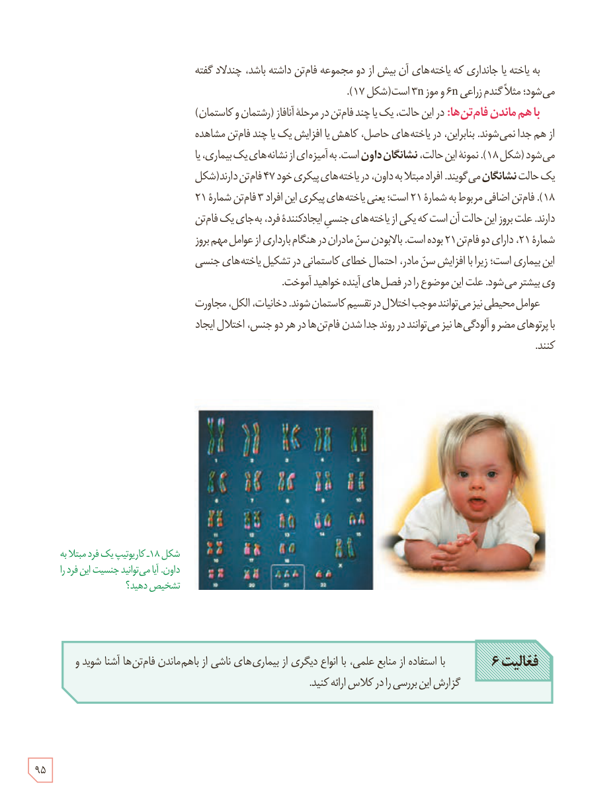

به یاخته یا جانداری که یاخته‌های آن بیش از دو مجموعه فام‌تن داشته باشد، چندلاد گفته می‌شود؛ مثلاً گندم زراعی 6n و موز 3n است (شکل ۱۷).

**با هم ماندن فام‌تن‌ها:** در این حالت، یک یا چند فام‌تن در مرحلۀ آنافاز (رشتمان و کاستمان) از هم جدا نمی‌شوند. بنابراین، در یاخته‌های حاصل، کاهش یا افزایش یک یا چند فام‌تن مشاهده می‌شود (شکل ۱۸). نمونۀ این حالت، نشانگان داون است. به آمیزه‌ای از نشانه‌های یک بیماری، یا یک حالت نشانگان می‌گویند. افراد مبتلا به داون، در یاخته‌های پیکری خود ۴۷ فام‌تن دارند (شکل ۱۸). فام‌تن اضافی مربوط به شمارۀ ۲۱ است؛ یعنی یاخته‌های پیکری این افراد ۳ فام‌تن شمارۀ ۲۱ دارند. علت بروز این حالت آن است که یکی از یاخته‌های جنسی ایجادکنندۀ فرد، به‌جای یک فام‌تن شمارۀ ۲۱، دارای دو فام‌تن ۲۱ بوده است. بالابودن سن مادران در هنگام بارداری از عوامل مهم بروز این بیماری است؛ زیرا با افزایش سن مادر، احتمال خطای کاستمانی در تشکیل یاخته‌های جنسی وی بیشتر می‌شود. علت این موضوع را در فصل‌های آینده خواهید آموخت.

عوامل محیطی نیز می‌توانند موجب اختلال در تقسیم کاستمان شوند. دخانیات، الکل، مجاورت با پرتوهای مضر و آلودگی‌ها نیز می‌توانند در روند جدا شدن فام‌تن‌ها در هر دو جنس، اختلال ایجاد کنند.

شکل ۱۸ـ کاریوتیپ یک فرد مبتلا به داون. آیا می‌توانید جنسیت این فرد را تشخیص دهید؟

**فعالیت ۶:** با استفاده از منابع علمی، با انواع دیگری از بیماری‌های ناشی از باهم ماندن فام‌تن‌ها آشنا شوید و گزارش این بررسی را در کلاس ارائه کنید.

۹۵

