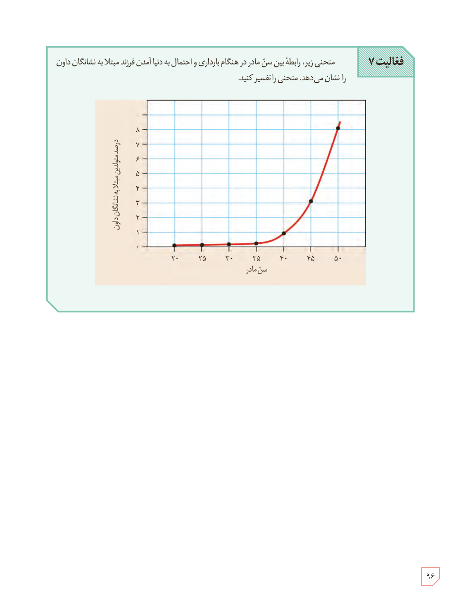

**فعالیت ۷:** منحنی زیر، رابطۀ بین سن مادر در هنگام بارداری و احتمال به دنیا آمدن فرزند مبتلا به نشانگان داون را نشان می‌دهد. منحنی را تفسیر کنید.

محور افقی: سن مادر. محور عمودی: درصد موارد مبتلا به نشانگان داون.

۹۶

