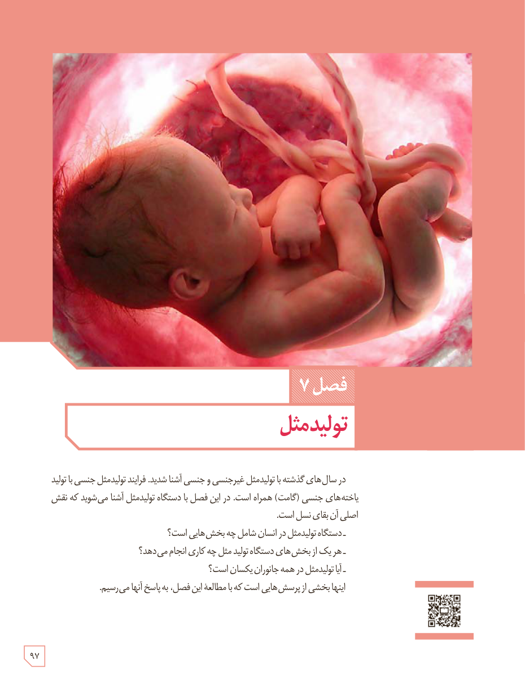

# فصل ۷: تولیدمثل

در سال‌های گذشته با تولیدمثل غیرجنسی و جنسی آشنا شدید. فرایند تولیدمثل جنسی با تولید یاخته‌های جنسی (گامت) همراه است. در این فصل با دستگاه تولیدمثل آشنا می‌شوید که نقش اصلی آن بقای نسل است.

- دستگاه تولیدمثل در انسان شامل چه بخش‌هایی است؟
- هر یک از بخش‌های دستگاه تولید مثل چه کاری انجام می‌دهد؟
- آیا تولیدمثل در همه جانوران یکسان است؟

اینها بخشی از پرسش‌هایی است که با مطالعۀ این فصل، به پاسخ آنها می‌رسیم.

۹۷

