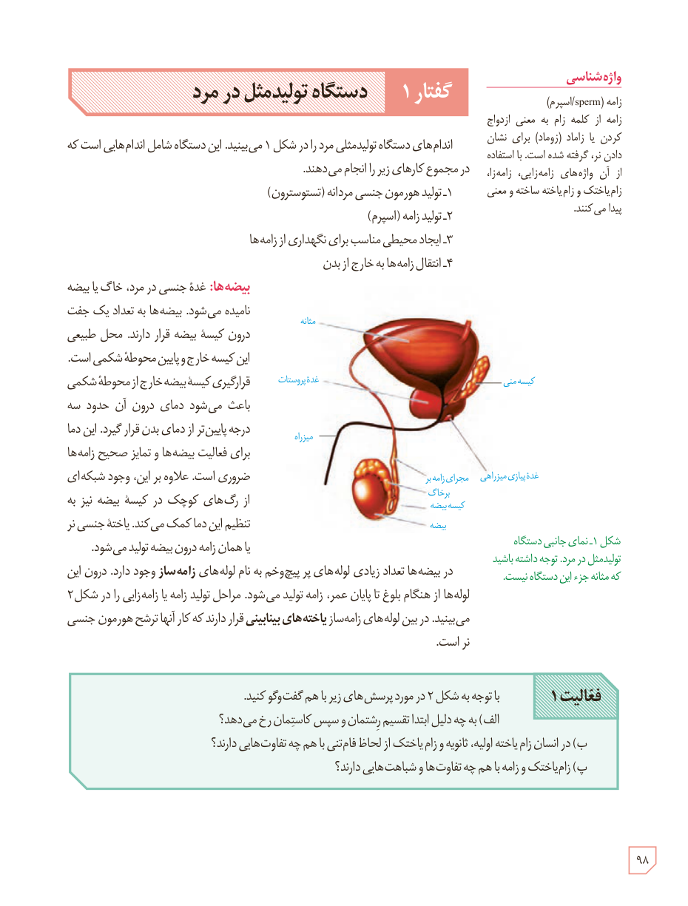

# گفتار ۱: دستگاه تولیدمثل در مرد

اندام‌های دستگاه تولیدمثلی مرد را در شکل ۱ می‌بینید. این دستگاه شامل اندام‌هایی است که در مجموع کارهای زیر را انجام می‌دهند.

۱ـ تولید هورمون جنسی مردانه (تستوسترون)  
۲ـ تولید زامه (اسپرم)  
۳ـ ایجاد محیطی مناسب برای نگهداری از زامه‌ها  
۴ـ انتقال زامه‌ها به خارج از بدن

**بیضه‌ها:** غدۀ جنسی در مرد، خاگ یا بیضه نامیده می‌شود. بیضه‌ها به تعداد یک جفت درون کیسۀ بیضه قرار دارند. محل طبیعی این کیسه خارج و پایین محوطۀ شکمی است. قرارگیری کیسۀ بیضه خارج از محوطۀ شکمی باعث می‌شود دمای درون آن حدود سه درجه پایین‌تر از دمای بدن قرار گیرد. این دما برای فعالیت بیضه‌ها و تمایز صحیح زامه‌ها ضروری است. علاوه بر این، وجود شبکه‌ای از رگ‌های کوچک در کیسۀ بیضه نیز به تنظیم این دما کمک می‌کند. یاختۀ جنسی نر یا همان زامه درون بیضه تولید می‌شود.

در بیضه‌ها تعداد زیادی لوله‌های پر پیچ‌وخم به نام لوله‌های زامه‌ساز وجود دارد. درون این لوله‌ها از هنگام بلوغ تا پایان عمر، زامه تولید می‌شود. مراحل تولید زامه یا زامه‌زایی را در شکل ۲ می‌بینید. در بین لوله‌های زامه‌ساز یاخته‌های بینابینی قرار دارند که کار آنها ترشح هورمون جنسی نر است.

شکل ۱ـ نمای جانبی دستگاه تولیدمثل در مرد. توجه داشته باشید که مثانه جزو این دستگاه نیست. برچسب‌ها: مثانه، غدۀ پروستات، میزراه، کیسۀ منی، مجرای زامه‌بر، برخاگ، کیسۀ بیضه، بیضه، غدۀ پیازی میزراهی.

**فعالیت ۱:** با توجه به شکل ۲ در مورد پرسش‌های زیر با هم گفت‌وگو کنید.  
الف) به چه دلیل ابتدا تقسیم رشتمان و سپس کاستمان رخ می‌دهد؟  
ب) در انسان زام‌یاختۀ اولیه، ثانویه و زام‌یاختک از لحاظ فام‌تنی با هم چه تفاوت‌هایی دارند؟  
پ) زام‌یاختک و زامه با هم چه تفاوت‌ها و شباهت‌هایی دارند؟

### واژه‌شناسی

زامه (sperm/اسپرم): زامه از کلمۀ زام به معنی ازدواج کردن یا زاماد (زوماد) برای نشان دادن نر، گرفته شده است. با استفاده از آن واژه‌های زامه‌زایی، زامه‌زا، زام‌یاختک و زام‌یاخته ساخته و معنی پیدا می‌کنند.

۹۸

