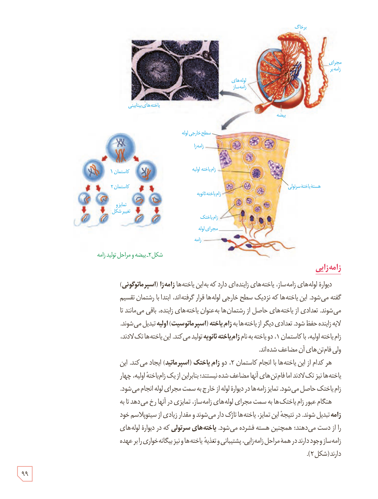

شکل ۲ـ بیضه و مراحل تولید زامه. برچسب‌ها: برخاگ، مجرای زامه‌بر، لوله‌های زامه‌ساز، بیضه، یاخته‌های بینابینی، سطح خارجی لوله، زامه‌زا، زام‌یاختۀ اولیه، زام‌یاختۀ ثانویه، زام‌یاختک، مجرای لوله، زامه، هستۀ یاختۀ سرتولی، کاستمان ۱، کاستمان ۲، تمایز و تغییر شکل.

## زامه‌زایی

دیوارۀ لوله‌های زامه‌ساز، یاخته‌های زاینده‌ای دارد که به این یاخته‌ها زامه‌زا (اسپرماتوگونی) گفته می‌شود. این یاخته‌ها که نزدیک سطح خارجی لوله‌ها قرار گرفته‌اند، ابتدا با رشتمان تقسیم می‌شوند. تعدادی از یاخته‌های حاصل از رشتمان‌ها به‌عنوان یاخته‌های زاینده، باقی می‌مانند تا لایۀ زاینده حفظ شود. تعدادی دیگر از یاخته‌ها به زام‌یاختۀ (اسپرماتوسیت) اولیه تبدیل می‌شوند. زام‌یاختۀ اولیه، با کاستمان ۱، دو یاخته به نام زام‌یاختۀ ثانویه تولید می‌کند. این یاخته‌ها تک‌لادند، ولی فام‌تن‌های آن مضاعف شده‌اند.

هر کدام از این یاخته‌ها با انجام کاستمان ۲، دو زام‌یاختک (اسپرماتید) ایجاد می‌کنند. این یاخته‌ها نیز تک‌لادند اما فام‌تن‌های آنها مضاعف شده نیستند؛ بنابراین از یک زام‌یاختۀ اولیه، چهار زام‌یاختک حاصل می‌شود. تمایز زامه‌ها در دیوارۀ لوله از خارج به سمت مجرای لوله انجام می‌شود. هنگام عبور زام‌یاختک‌ها به سمت مجرای لوله‌های زامه‌ساز، تمایزی در آنها رخ می‌دهد تا به زامه تبدیل شوند. در نتیجۀ این تمایز، یاخته‌ها تاژک‌دار می‌شوند و مقدار زیادی از سیتوپلاسم خود را از دست می‌دهند؛ همچنین هسته فشرده می‌شود. یاخته‌های سرتولی که در دیوارۀ لوله‌های زامه‌ساز وجود دارند در همۀ مراحل زامه‌زایی، پشتیبانی و تغذیۀ یاخته‌ها و نیز بیگانه‌خواری را بر عهده دارند (شکل ۲).

۹۹

