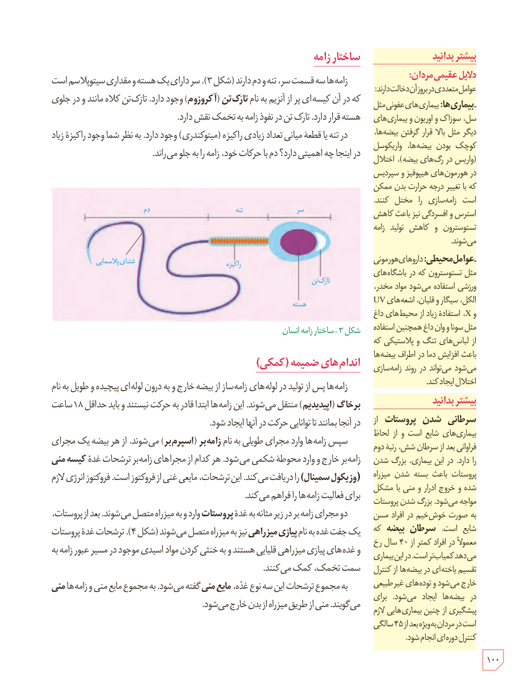

## ساختار زامه

زامه‌ها سه قسمت سر، تنه و دم دارند (شکل ۳). سر دارای یک هسته و مقداری سیتوپلاسم است که در آن کیسه‌ای پر از آنزیم به نام تارک‌تن (آکروزوم) وجود دارد. تارک‌تن کلاه‌مانند و در جلوی هسته قرار دارد. تارک‌تن در نفوذ زامه به تخمک نقش دارد.

در تنه یا قطعۀ میانی تعداد زیادی راکیزه (میتوکندری) وجود دارد. به نظر شما وجود راکیزۀ زیاد در اینجا چه اهمیتی دارد؟ دم با حرکات خود، زامه را به جلو می‌راند.

شکل ۳ـ ساختار زامۀ انسان. برچسب‌ها: سر، تنه، دم، غشای پلاسمایی، راکیزه، تارک‌تن، هسته.

## اندام‌های ضمیمه (کمکی)

زامه‌ها پس از تولید در لوله‌های زامه‌ساز از بیضه خارج و به درون لوله‌ای پیچیده و طویل به نام برخاگ (اپیدیدیم) منتقل می‌شوند. این زامه‌ها ابتدا قادر به حرکت نیستند و باید حداقل ۱۸ ساعت در آنجا بمانند تا توانایی حرکت در آنها ایجاد شود.

سپس زامه‌ها وارد مجرای طویلی به نام زامه‌بر (اسپرم‌بر) می‌شوند. از هر بیضه یک مجرای زامه‌بر خارج و وارد محوطۀ شکمی می‌شود. هر کدام از مجراهای زامه‌بر ترشحات غدۀ کیسۀ منی (وزیکول سمینال) را دریافت می‌کند. این ترشحات، مایعی غنی از فروکتوز است. فروکتوز انرژی لازم برای فعالیت زامه‌ها را فراهم می‌کند.

دو مجرای زامه‌بر در زیر مثانه به غدۀ پروستات وارد و به میزراه متصل می‌شوند. بعد از پروستات، یک جفت غده به نام پیازی میزراهی نیز به میزراه متصل می‌شوند (شکل ۴). ترشحات غدۀ پروستات و غده‌های پیازی میزراهی قلیایی هستند و به خنثی کردن مواد اسیدی موجود در مسیر عبور زامه به سمت تخمک، کمک می‌کنند.

به مجموع ترشحات این سه نوع غده، مایع منی گفته می‌شود. به مجموع مایع منی و زامه‌ها منی می‌گویند. منی از طریق میزراه از بدن خارج می‌شود.

### بیشتر بدانید: دلایل عقیمی مردان

عوامل متعددی در بروز آن دخالت دارند: بیماری‌ها: بیماری‌های عفونی مثل سل، سوزاک و اوریون و بیماری‌های دیگر مثل بالا قرار گرفتن بیضه‌ها، کوچک بودن بیضه‌ها، واریکوسل (واریس در سیاهرگ بیضه)، اختلال در هورمون‌های هیپوفیز و سپردیس که با تغییر درجۀ حرارت بدن ممکن است زامه‌سازی را مختل کنند. استرس و افسردگی نیز باعث کاهش تستوسترون و کاهش تولید زامه می‌شوند.

عوامل محیطی: داروهای هورمونی مثل تستوسترون که در باشگاه‌های ورزشی استفاده می‌شود، مواد مخدر، الکل، سیگار و قلیان، اشعه‌های UV و X، استفادۀ زیاد از محیط‌های داغ مثل سونا و وان داغ، همچنین استفاده از لباس‌های تنگ و پلاستیکی که باعث افزایش دما در اطراف بیضه‌ها می‌شود می‌تواند در روند زامه‌سازی اختلال ایجاد کند.

### بیشتر بدانید: سرطان غدد پروستات

از بیماری‌های شایع است و از لحاظ فراوانی بعد از سرطان شش، رتبۀ دوم را دارد. در این بیماری، بزرگ شدن پروستات باعث بسته شدن میزراه شده و خروج ادرار و منی با مشکل مواجه می‌شود. بزرگ شدن پروستات به صورت خوش‌خیم در افراد مسن شایع است. سرطان بیضه که معمولاً در افراد کمتر از ۴۰ سال رخ می‌دهد کمیاب‌تر است. در این بیماری تقسیم یاخته‌ای در بیضه‌ها از کنترل خارج می‌شود و توده‌های غیرطبیعی در بیضه‌ها ایجاد می‌شود. برای پیشگیری از چنین بیماری‌هایی لازم است در مردان به‌ویژه بعد از ۴۵ سالگی کنترل دوره‌ای انجام شود.

۱۰۰

