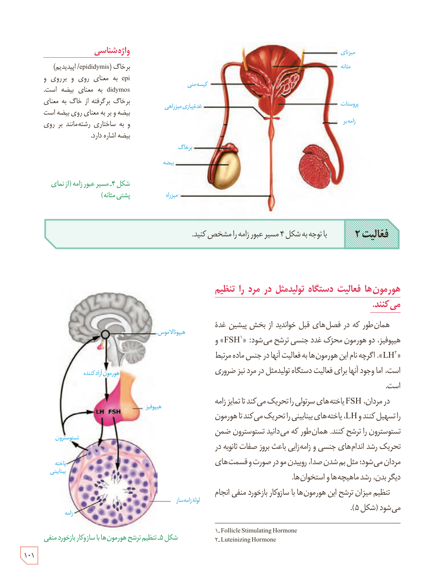

شکل ۴ـ مسیر عبور زامه (از نمای پشتی مثانه). برچسب‌ها: میزنای، مثانه، کیسۀ منی، پروستات، غدۀ پیازی میزراهی، زامه‌بر، برخاگ، بیضه، میزراه.

**فعالیت ۲:** با توجه به شکل ۴ مسیر عبور زامه را مشخص کنید.

## هورمون‌ها فعالیت دستگاه تولیدمثل در مرد را تنظیم می‌کنند.

همان‌طور که در فصل‌های قبل خواندید از بخش پیشین غدۀ هیپوفیز، دو هورمون محرک غدد جنسی ترشح می‌شود: «FSH»¹ و «LH»². اگرچه نام این هورمون‌ها به فعالیت آنها در جنس ماده مرتبط است، اما وجود آنها برای فعالیت دستگاه تولیدمثل در مرد نیز ضروری است.

در مردان، FSH یاخته‌های سرتولی را تحریک می‌کند تا تمایز زامه را تسهیل کنند و LH، یاخته‌های بینابینی را تحریک می‌کند تا هورمون تستوسترون را ترشح کنند. همان‌طور که می‌دانید تستوسترون ضمن تحریک رشد اندام‌های جنسی و زامه‌زایی باعث بروز صفات ثانویه در مردان می‌شود؛ مثل بم شدن صدا، روییدن مو در صورت و قسمت‌های دیگر بدن، رشد ماهیچه‌ها و استخوان‌ها.

تنظیم میزان ترشح این هورمون‌ها با سازوکار بازخورد منفی انجام می‌شود (شکل ۵).

شکل ۵ـ تنظیم ترشح هورمون‌ها با سازوکار بازخورد منفی. برچسب‌ها: هیپوتالاموس، هورمون آزادکننده، هیپوفیز، LH، FSH، تستوسترون، یاختۀ بینابینی، لولۀ زامه‌ساز، زامه.

### واژه‌شناسی

برخاگ (epididymis/اپیدیدیم): epi به معنای روی و برروی و didymos به معنای بیضه است. برخاگ برگرفته از خاگ به معنای بیضه و بر به معنای روی بیضه است و به ساختاری رشته‌مانند بر روی بیضه اشاره دارد.

۱ـ Follicle Stimulating Hormone  
۲ـ Luteinizing Hormone

۱۰۱

