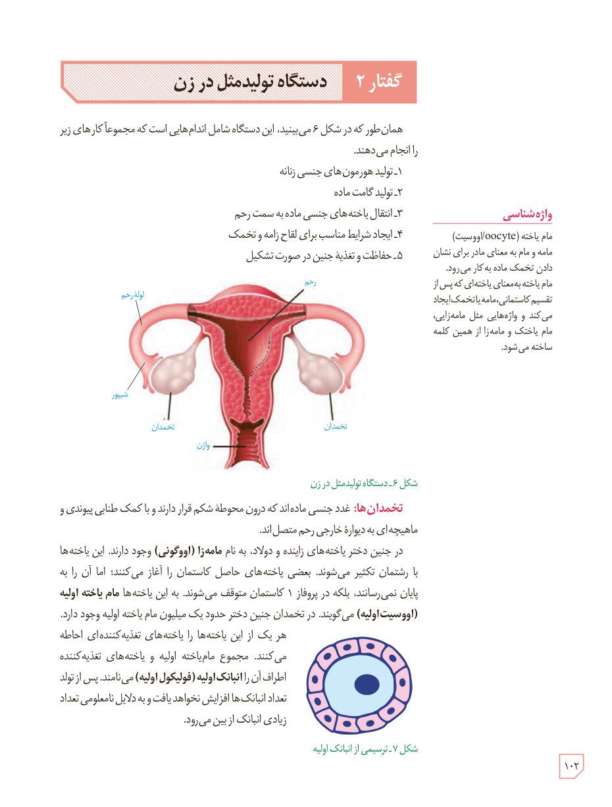

# گفتار ۲: دستگاه تولیدمثل در زن

همان‌طور که در شکل ۶ می‌بینید، این دستگاه شامل اندام‌هایی است که مجموعاً کارهای زیر را انجام می‌دهند.

۱ـ تولید هورمون‌های جنسی زنانه  
۲ـ تولید گامت ماده  
۳ـ انتقال یاخته‌های جنسی ماده به سمت رحم  
۴ـ ایجاد شرایط مناسب برای لقاح زامه و تخمک  
۵ـ حفاظت و تغذیۀ جنین در صورت تشکیل

شکل ۶ـ دستگاه تولیدمثل در زن. برچسب‌ها: رحم، لولۀ رحم، شیپور، تخمدان، واژن.

**تخمدان‌ها:** غدد جنسی ماده‌اند که درون محوطۀ شکم قرار دارند و با کمک طنابی پیوندی و ماهیچه‌ای به دیوارۀ خارجی رحم متصل‌اند.

در جنین دختر یاخته‌های زاینده و دولاد، به نام مامه‌زا (اووگونی) وجود دارند. این یاخته‌ها با رشتمان تکثیر می‌شوند. بعضی یاخته‌های حاصل کاستمان را آغاز می‌کنند؛ اما آن را به پایان نمی‌رسانند، بلکه در پروفاز ۱ کاستمان متوقف می‌شوند. به این یاخته‌ها مام‌یاختۀ اولیه (اووسیت اولیه) می‌گویند. در تخمدان جنین دختر حدود یک میلیون مام‌یاختۀ اولیه وجود دارد.

هر یک از این یاخته‌ها را یاخته‌های تغذیه‌کننده‌ای احاطه می‌کنند. مجموع مام‌یاختۀ اولیه و یاخته‌های تغذیه‌کنندۀ اطراف آن را انبانک اولیه (فولیکول اولیه) می‌نامند. پس از تولد تعداد انبانک‌ها افزایش نخواهد یافت و به دلایل نامعلومی تعداد زیادی انبانک از بین می‌رود.

شکل ۷ـ ترسیمی از انبانک اولیه.

### واژه‌شناسی

مام‌یاخته (oocyte/اووسیت): مامه و مام به معنی مادر برای نشان دادن تخمک ماده به کار می‌رود. مام‌یاخته به معنای یاخته‌ای که پس از تقسیم کاستمانی، مامه یا تخمک ایجاد می‌کند و واژه‌هایی مثل مامه‌زایی، مام‌یاختک و مامه‌زا از همین کلمه ساخته می‌شود.

۱۰۲

