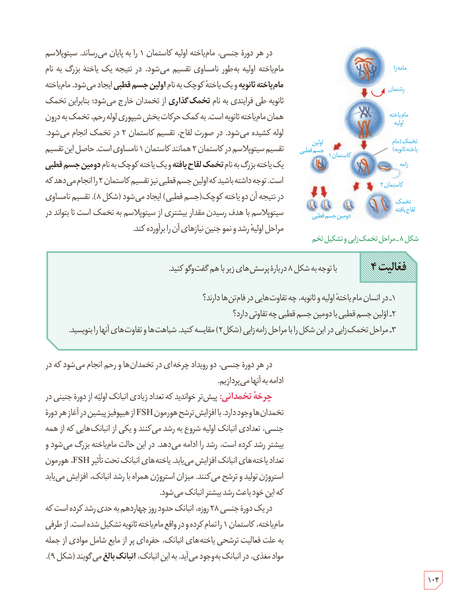

در هر دورۀ جنسی، مام‌یاختۀ اولیه کاستمان ۱ را به پایان می‌رساند. سیتوپلاسم مام‌یاختۀ اولیه به‌طور نامساوی تقسیم می‌شود، در نتیجه یک یاختۀ بزرگ به نام مام‌یاختۀ ثانویه و یک یاختۀ کوچک به نام اولین جسم قطبی ایجاد می‌شود. مام‌یاختۀ ثانویه طی فرایندی به نام تخمک‌گذاری از تخمدان خارج می‌شود؛ بنابراین تخمک همان مام‌یاختۀ ثانویه است. به کمک حرکات بخش شیپوری لولۀ رحم، تخمک به درون لوله کشیده می‌شود. در صورت لقاح، تقسیم کاستمان ۲ در تخمک انجام می‌شود. تقسیم سیتوپلاسم در کاستمان ۲ همانند کاستمان ۱ نامساوی است. حاصل این تقسیم یک یاختۀ بزرگ به نام تخمک لقاح‌یافته و یک یاختۀ کوچک به نام دومین جسم قطبی است. توجه داشته باشید که اولین جسم قطبی نیز تقسیم کاستمان ۲ را انجام می‌دهد که در نتیجۀ آن دو یاختۀ کوچک (جسم قطبی) ایجاد می‌شود (شکل ۸). تقسیم نامساوی سیتوپلاسم با هدف رسیدن مقدار بیشتری از سیتوپلاسم به تخمک است تا بتواند در مراحل اولیۀ رشد و نمو جنین نیازهای آن را برآورده کند.

شکل ۸ـ مراحل تخمک‌زایی و تشکیل تخم. برچسب‌ها: مامه‌زا، رشتمان، مام‌یاختۀ اولیه، کاستمان ۱، اولین جسم قطبی، تخمک (مام‌یاختۀ ثانویه)، زامه، کاستمان ۲، دومین جسم قطبی، تخمک لقاح‌یافته.

**فعالیت ۴:** با توجه به شکل ۸ دربارۀ پرسش‌های زیر با هم گفت‌وگو کنید.  
۱ـ در انسان مام‌یاختۀ اولیه و ثانویه، چه تفاوت‌هایی در فام‌تن‌ها دارند؟  
۲ـ اولین جسم قطبی با دومین جسم قطبی چه تفاوتی دارد؟  
۳ـ مراحل تخمک‌زایی در این شکل را با مراحل زامه‌زایی (شکل ۲) مقایسه کنید. شباهت‌ها و تفاوت‌های آنها را بنویسید.

در هر دورۀ جنسی، دو رویداد چرخه‌ای در تخمدان‌ها و رحم انجام می‌شود که در ادامه به آنها می‌پردازیم.

**چرخۀ تخمدانی:** پیش‌تر خواندید که تعداد زیادی انبانک اولیه از دورۀ جنینی در تخمدان‌ها وجود دارد. با افزایش ترشح هورمون FSH از هیپوفیز پیشین در آغاز هر دورۀ جنسی، تعدادی انبانک اولیه شروع به رشد می‌کنند و یکی از انبانک‌هایی که از همه بیشتر رشد کرده است، رشد را ادامه می‌دهد. در این حالت مام‌یاخته بزرگ می‌شود و تعداد یاخته‌های انبانک افزایش می‌یابد. یاخته‌های انبانک تحت تأثیر FSH، هورمون استروژن تولید و ترشح می‌کنند. میزان استروژن همراه با رشد انبانک، افزایش می‌یابد که این خود باعث رشد بیشتر انبانک می‌شود.

در یک دورۀ جنسی ۲۸ روزه، انبانک حدود روز چهاردهم به حدی رشد کرده است که مام‌یاخته، کاستمان ۱ را تمام کرده و در واقع مام‌یاختۀ ثانویه تشکیل شده است. از طرفی به علت فعالیت ترشحی یاخته‌های انبانک، حفره‌ای پر از مایع شامل موادی از جمله مواد مغذی، در انبانک به‌وجود می‌آید. به این انبانک، انبانک بالغ می‌گویند (شکل ۹).

۱۰۴

