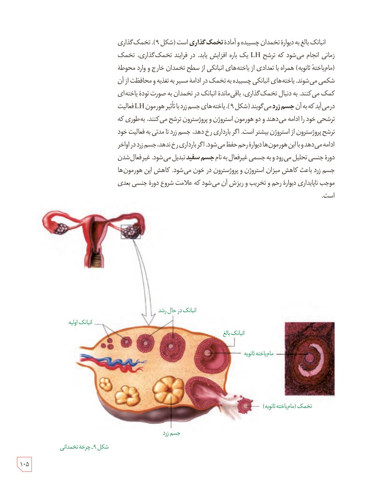

انبانک بالغ به دیوارۀ تخمدان چسبیده و آمادۀ تخمک‌گذاری است (شکل ۹). تخمک‌گذاری زمانی انجام می‌شود که ترشح LH یک‌باره افزایش یابد. در فرایند تخمک‌گذاری، تخمک (مام‌یاختۀ ثانویه) همراه با تعدادی از یاخته‌های انبانکی از سطح تخمدان خارج و وارد محوطۀ شکمی می‌شوند. یاخته‌های انبانکی چسبیده به تخمک در ادامۀ مسیر به تغذیه و محافظت از آن کمک می‌کنند. به دنبال تخمک‌گذاری، باقی‌ماندۀ انبانک در تخمدان به صورت تودۀ یاخته‌ای درمی‌آید که به آن جسم زرد می‌گویند (شکل ۹). یاخته‌های جسم زرد با تأثیر هورمون LH فعالیت ترشحی خود را ادامه می‌دهند و دو هورمون استروژن و پروژسترون ترشح می‌کنند، به‌طوری که ترشح پروژسترون از استروژن بیشتر است. اگر بارداری رخ دهد، جسم زرد تا مدتی به فعالیت خود ادامه می‌دهد و با این هورمون‌ها دیوارۀ رحم حفظ می‌شود. اگر بارداری رخ ندهد، جسم زرد در اواخر دورۀ جنسی تحلیل می‌رود و به جسمی غیرفعال به نام جسم سفید تبدیل می‌شود. غیرفعال شدن جسم زرد باعث کاهش میزان استروژن و پروژسترون در خون می‌شود. کاهش این هورمون‌ها موجب ناپایداری دیوارۀ رحم و تخریب و ریزش آن می‌شود که علامت شروع دورۀ جنسی بعدی است.

شکل ۹ـ چرخۀ تخمدانی. برچسب‌ها: انبانک اولیه، انبانک در حال رشد، انبانک بالغ، مام‌یاختۀ ثانویه، تخمک (مام‌یاختۀ ثانویه)، جسم زرد.

۱۰۵

