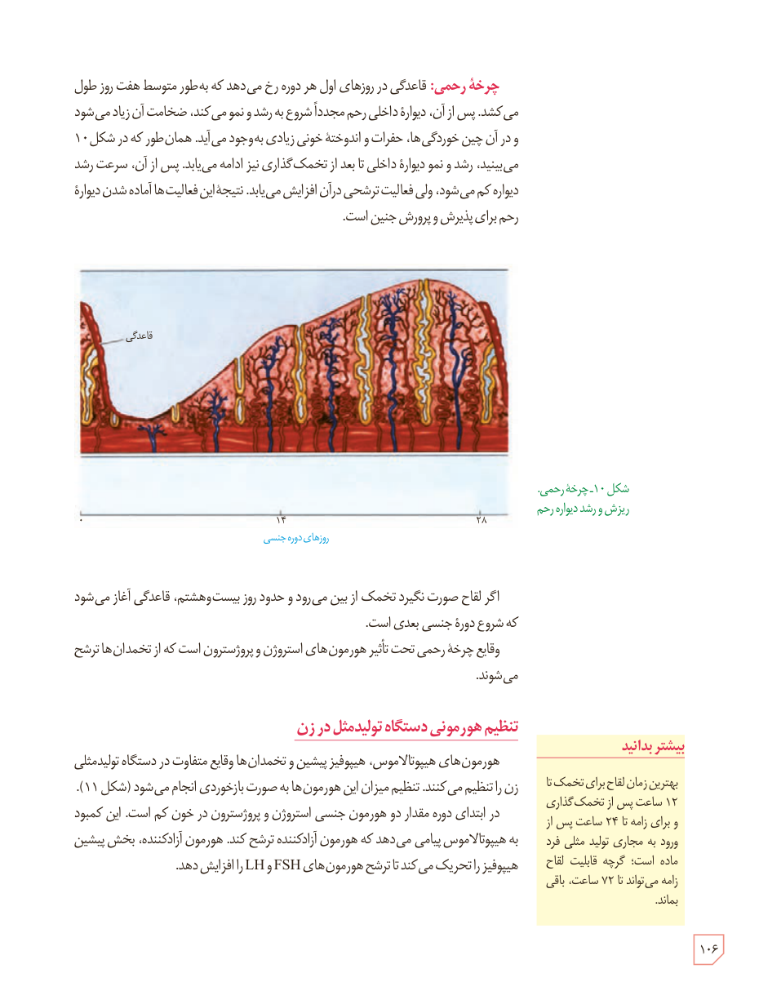

**چرخۀ رحمی:** قاعدگی در روزهای اول هر دوره رخ می‌دهد که به‌طور متوسط هفت روز طول می‌کشد. پس از آن، دیوارۀ داخلی رحم مجدداً شروع به رشد و نمو می‌کند، ضخامت آن زیاد می‌شود و در آن چین‌خوردگی‌ها، حفرات و اندوختۀ خونی زیادی به‌وجود می‌آید. همان‌طور که در شکل ۱۰ می‌بینید، رشد و نمو دیوارۀ داخلی تا بعد از تخمک‌گذاری نیز ادامه می‌یابد. پس از آن، سرعت رشد دیواره کم می‌شود، ولی فعالیت ترشحی در آن افزایش می‌یابد. نتیجۀ این فعالیت‌ها آماده شدن دیوارۀ رحم برای پذیرش و پرورش جنین است.

شکل ۱۰ـ چرخۀ رحمی، ریزش و رشد دیوارۀ رحم. برچسب‌ها: قاعدگی، روزهای دورۀ جنسی، ۱۴، ۲۸.

اگر لقاح صورت نگیرد تخمک از بین می‌رود و حدود روز بیست‌وهشتم، قاعدگی آغاز می‌شود که شروع دورۀ جنسی بعدی است.

وقایع چرخۀ رحمی تحت تأثیر هورمون‌های استروژن و پروژسترون است که از تخمدان‌ها ترشح می‌شوند.

## تنظیم هورمونی دستگاه تولیدمثل در زن

هورمون‌های هیپوتالاموس، هیپوفیز پیشین و تخمدان‌ها وقایع متفاوت در دستگاه تولیدمثلی زن را تنظیم می‌کنند. تنظیم میزان این هورمون‌ها به صورت بازخوردی انجام می‌شود (شکل ۱۱).

در ابتدای دوره مقدار دو هورمون جنسی استروژن و پروژسترون در خون کم است. این کمبود به هیپوتالاموس پیامی می‌دهد که هورمون آزادکننده ترشح کند. هورمون آزادکننده، بخش پیشین هیپوفیز را تحریک می‌کند تا ترشح هورمون‌های FSH و LH را افزایش دهد.

### بیشتر بدانید

بهترین زمان لقاح برای تخمک تا ۱۲ ساعت پس از تخمک‌گذاری و برای زامه تا ۲۴ ساعت پس از ورود به مجاری تولید مثلی فرد ماده است؛ گرچه قابلیت لقاح زامه می‌تواند تا ۷۲ ساعت، باقی بماند.

۱۰۶

