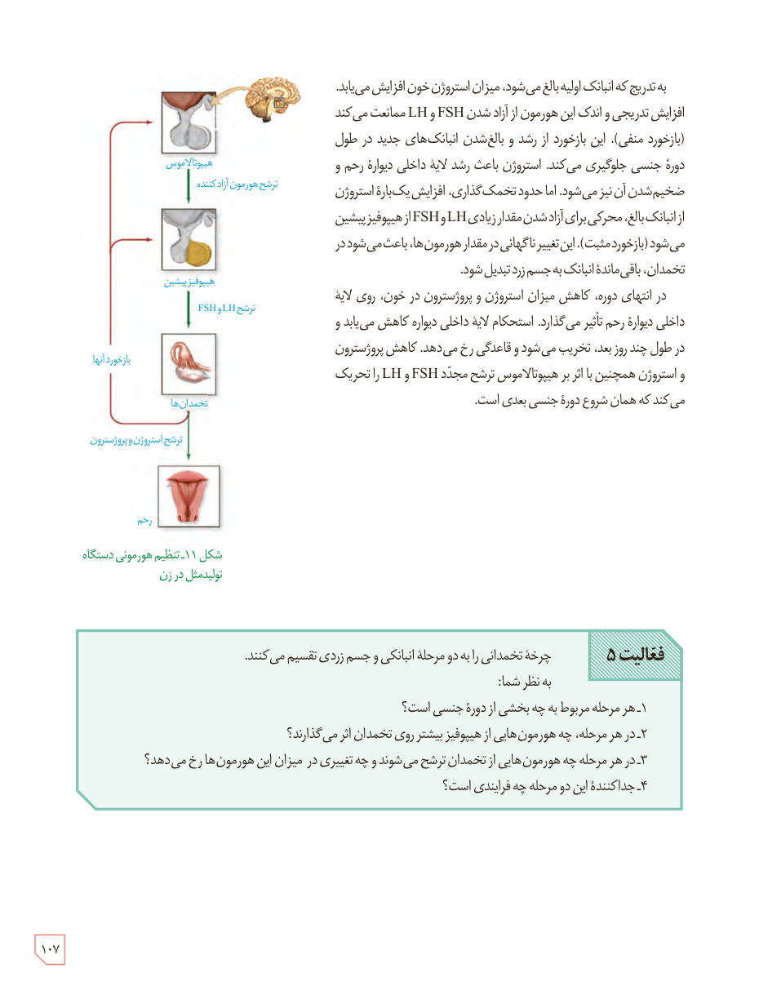

به‌تدریج که انبانک اولیه بالغ می‌شود، میزان استروژن خون افزایش می‌یابد. افزایش تدریجی و اندک این هورمون از آزاد شدن FSH و LH ممانعت می‌کند (بازخورد منفی). این بازخورد از رشد و بالغ شدن انبانک‌های جدید در طول دورۀ جنسی جلوگیری می‌کند. استروژن باعث رشد لایۀ داخلی دیوارۀ رحم و ضخیم‌شدن آن نیز می‌شود. اما حدود تخمک‌گذاری، افزایش یک‌بارۀ استروژن از انبانک بالغ، محرکی برای آزاد شدن مقدار زیادی LH و FSH از هیپوفیز پیشین می‌شود (بازخورد مثبت). این تغییر ناگهانی در مقدار هورمون‌ها، باعث می‌شود در تخمدان، باقی‌ماندۀ انبانک به جسم زرد تبدیل شود.

در انتهای دوره، کاهش میزان استروژن و پروژسترون در خون، روی لایۀ داخلی دیوارۀ رحم تأثیر می‌گذارد. استحکام لایۀ داخلی دیوارۀ رحم کاهش می‌یابد و در طول چند روز بعد، تخریب می‌شود و قاعدگی رخ می‌دهد. کاهش پروژسترون و استروژن همچنین با اثر بر هیپوتالاموس ترشح مجدد FSH و LH را تحریک می‌کند که همان شروع دورۀ جنسی بعدی است.

شکل ۱۱ـ تنظیم هورمونی دستگاه تولیدمثل در زن. برچسب‌ها: هیپوتالاموس، ترشح هورمون آزادکننده، هیپوفیز پیشین، ترشح LH و FSH، بازخورد آنها، تخمدان‌ها، ترشح استروژن و پروژسترون، رحم.

**فعالیت ۵:** چرخۀ تخمدانی را به دو مرحلۀ انبانکی و جسم زردی تقسیم می‌کنند. به نظر شما:  
۱ـ هر مرحله مربوط به چه بخشی از دورۀ جنسی است؟  
۲ـ در هر مرحله، چه هورمون‌هایی از هیپوفیز بیشتر روی تخمدان اثر می‌گذارند؟  
۳ـ در هر مرحله چه هورمون‌هایی از تخمدان ترشح می‌شوند و چه تغییری در میزان این هورمون‌ها رخ می‌دهد؟  
۴ـ جداکنندۀ این دو مرحله چه فرایندی است؟

۱۰۷

