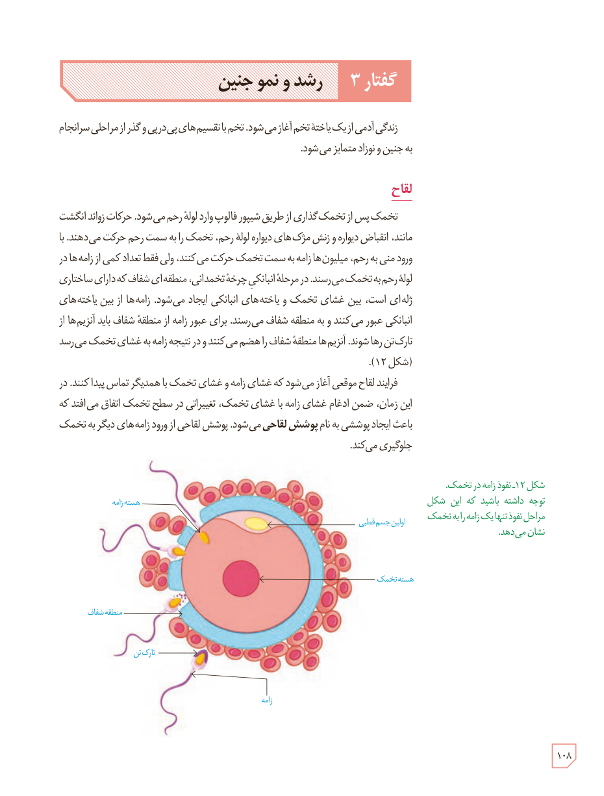

# گفتار ۳: رشد و نمو جنین

زندگی آدمی از یک یاختۀ تخم آغاز می‌شود. تخم با تقسیم‌های پی‌درپی و گذر از مراحلی سرانجام به جنین و نوزاد متمایز می‌شود.

## لقاح

تخمک پس از تخمک‌گذاری از طریق شیپور فالوپ وارد لولۀ رحم می‌شود. حرکات زوائد انگشت‌مانند، انقباض دیواره و زنش مژک‌های دیوارۀ لولۀ رحم، تخمک را به سمت رحم حرکت می‌دهند. با ورود منی به رحم، میلیون‌ها زامه به سمت تخمک حرکت می‌کنند، ولی فقط تعداد کمی از زامه‌ها در لولۀ رحم به تخمک می‌رسند. در مرحلۀ انبانکی چرخۀ تخمدانی، منطقه‌ای شفاف که دارای ساختاری ژله‌ای است، بین غشای تخمک و یاخته‌های انبانکی ایجاد می‌شود. زامه‌ها از بین یاخته‌های انبانکی عبور می‌کنند و به منطقۀ شفاف می‌رسند. برای عبور زامه از منطقۀ شفاف باید آنزیم‌ها از تارک‌تن رها شوند. آنزیم‌ها منطقۀ شفاف را هضم می‌کنند و در نتیجه زامه به غشای تخمک می‌رسد (شکل ۱۲).

فرایند لقاح موقعی آغاز می‌شود که غشای زامه و غشای تخمک با همدیگر تماس پیدا کنند. در این زمان، ضمن ادغام غشای زامه با غشای تخمک، تغییراتی در سطح تخمک اتفاق می‌افتد که باعث ایجاد پوششی به نام **پوشش لقاحی** می‌شود. پوشش لقاحی از ورود زامه‌های دیگر به تخمک جلوگیری می‌کند.

شکل ۱۲ـ نفوذ زامه در تخمک. توجه داشته باشید که این شکل مراحل نفوذ تنها یک زامه را به تخمک نشان می‌دهد. برچسب‌ها: هستۀ زامه، اولین جسم قطبی، هستۀ تخمک، منطقۀ شفاف، تارک‌تن، زامه.

۱۰۸

