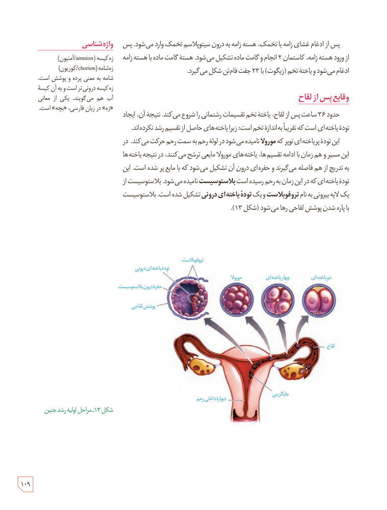

پس از ادغام غشای زامه با تخمک، هستۀ زامه به درون سیتوپلاسم تخمک وارد می‌شود. پس از ورود هستۀ زامه، کاستمان ۲ انجام و گامت ماده تشکیل می‌شود. هستۀ گامت ماده با هستۀ زامه ادغام می‌شود و یاختۀ تخم (زیگوت) با ۲۳ جفت فام‌تن شکل می‌گیرد.

## وقایع پس از لقاح

حدود ۳۶ ساعت پس از لقاح، یاختۀ تخم تقسیمات رشتمانی را شروع می‌کند. نتیجۀ آن، ایجاد تودۀ یاخته‌ای است که تقریباً به اندازۀ تخم است؛ زیرا یاخته‌های حاصل از تقسیم رشد نکرده‌اند. این تودۀ پریاخته‌ای توپر که **مورولا** نامیده می‌شود در لولۀ رحم به سمت رحم حرکت می‌کند. در این مسیر و هم‌زمان با ادامۀ تقسیم‌ها، یاخته‌های مورولا مایعی ترشح می‌کنند، در نتیجه یاخته‌ها به تدریج از هم فاصله می‌گیرند و حفره‌ای درون آن تشکیل می‌شود که با مایع پر شده است. این تودۀ یاخته‌ای که در این زمان به رحم رسیده است **بلاستوسیست** نامیده می‌شود. بلاستوسیست از یک لایۀ بیرونی به نام **تروفوبلاست** و یک **تودۀ یاخته‌ای درونی** تشکیل شده است. بلاستوسیست با پاره شدن پوشش لقاحی رها می‌شود (شکل ۱۳).

### واژه‌شناسی

زِه‌کیسه (amnion/آمنیون)

زِه‌شامه (chorion/کوریون)

شامه به معنی پرده و پوشش است. زِه‌کیسه درونی‌تر است و به آن کیسۀ آب هم می‌گویند. یکی از معانی «زِه» در زبان فارسی، «بچه» است.

شکل ۱۳ـ مراحل اولیۀ رشد جنین. برچسب‌ها: تروفوبلاست، تودۀ یاخته‌ای درونی، حفرۀ درون بلاستوسیست، پوشش لقاحی، مورولا، چهاریخته‌ای، دویافته‌ای، لقاح، جایگزینی، دیوارۀ داخلی رحم.

۱۰۹

