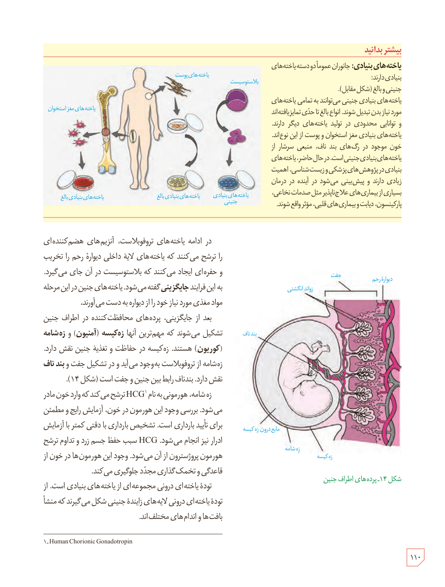

### بیشتر بدانید

**یاخته‌های بنیادی:** جانوران عموماً دو دسته یاخته‌های بنیادی دارند: جنینی و بالغ (شکل مقابل).

یاخته‌های بنیادی جنینی می‌توانند به تمامی یاخته‌های مورد نیاز بدن تبدیل شوند. انواع بالغ تا حدی تمایزیافته‌اند و توانایی محدودی در تولید یاخته‌های دیگر دارند. یاخته‌های بنیادی مغز استخوان و پوست از این نوع‌اند. خون موجود در رگ‌های بند ناف، منبعی سرشار از یاخته‌های بنیادی جنینی است. در حال حاضر، یاخته‌های بنیادی در پژوهش‌های پزشکی و زیست‌شناسی، اهمیت زیادی دارند و پیش‌بینی می‌شود در آینده در درمان بسیاری از بیماری‌های علاج‌ناپذیر مثل صدمات نخاعی، پارکینسون، دیابت و بیماری‌های قلبی، مؤثر واقع شوند.

برچسب‌های شکل: بلاستوسیست، یاخته‌های پوست، یاخته‌های مغز استخوان، یاخته‌های بنیادی جنینی، یاخته‌های بنیادی بالغ.

در ادامه یاخته‌های تروفوبلاست، آنزیم‌های هضم‌کننده‌ای را ترشح می‌کنند که یاخته‌های لایۀ داخلی دیوارۀ رحم را تخریب و حفره‌ای ایجاد می‌کنند که بلاستوسیست در آن جای می‌گیرد. به این فرایند **جایگزینی** گفته می‌شود. یاخته‌های جنین در این مرحله مواد مغذی مورد نیاز خود را از دیواره به دست می‌آورند.

بعد از جایگزینی، پرده‌های محافظت‌کننده در اطراف جنین تشکیل می‌شوند که مهم‌ترین آنها **زِه‌کیسه (آمنیون)** و **زِه‌شامه (کوریون)** هستند. زه‌کیسه در حفاظت و تغذیۀ جنین نقش دارد. زه‌شامه از تروفوبلاست به‌وجود می‌آید و در تشکیل جفت و **بند ناف** نقش دارد. بندناف رابط بین جنین و جفت است (شکل ۱۴).

زه‌شامه، هورمونی به نام HCG¹ ترشح می‌کند که وارد خون مادر می‌شود. بررسی وجود این هورمون در خون، آزمایش رایج و مطمئن برای تأیید بارداری است. تشخیص بارداری با دقتی کمتر با آزمایش ادرار نیز انجام می‌شود. HCG سبب حفظ جسم زرد و تداوم ترشح هورمون پروژسترون از آن می‌شود. وجود این هورمون‌ها در خون از قاعدگی و تخمک‌گذاری مجدد جلوگیری می‌کند.

تودۀ یاخته‌ای درونی مجموعه‌ای از یاخته‌های بنیادی است. از تودۀ یاخته‌ای درونی لایه‌های زایندۀ جنینی شکل می‌گیرند که منشأ بافت‌ها و اندام‌های مختلف‌اند.

شکل ۱۴ـ پرده‌های اطراف جنین. برچسب‌ها: جفت، دیوارۀ رحم، زوائد انگشتی، بند ناف، مایع درون زه‌کیسه، زه‌شامه، زه‌کیسه.

۱ـ Human Chorionic Gonadotropin

۱۱۰

