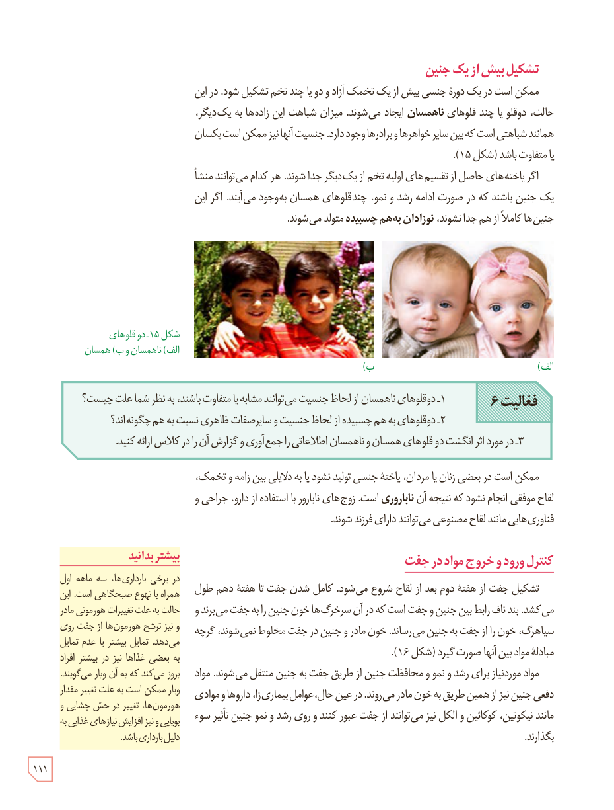

## تشکیل بیش از یک جنین

ممکن است در یک دورۀ جنسی بیش از یک تخمک آزاد و دو یا چند تخم تشکیل شود. در این حالت، دوقلو یا چند قلوهای **ناهمسان** ایجاد می‌شوند. میزان شباهت این زاده‌ها به یکدیگر، همانند شباهتی است که بین سایر خواهرها و برادرها وجود دارد. جنسیت آنها نیز ممکن است یکسان یا متفاوت باشد (شکل ۱۵).

اگر یاخته‌های حاصل از تقسیم‌های اولیۀ تخم از یکدیگر جدا شوند، هر کدام می‌توانند منشأ یک جنین باشند که در صورت ادامۀ رشد و نمو، چندقلوهای همسان به‌وجود می‌آیند. اگر این جنین‌ها کاملاً از هم جدا نشوند، **نوزادان به‌هم چسبیده** متولد می‌شوند.

شکل ۱۵ـ دوقلوهای (الف) ناهمسان و (ب) همسان

**فعالیت ۶**

۱ـ دوقلوهای ناهمسان از لحاظ جنسیت می‌توانند مشابه یا متفاوت باشند، به نظر شما علت چیست؟

۲ـ دوقلوهای به هم چسبیده از لحاظ جنسیت و سایر صفات ظاهری نسبت به هم چگونه‌اند؟

۳ـ در مورد اثر انگشت دوقلوهای همسان و ناهمسان اطلاعاتی را جمع‌آوری و گزارش آن را در کلاس ارائه کنید.

ممکن است در بعضی زنان یا مردان، یاختۀ جنسی تولید نشود یا به دلایلی بین زامه و تخمک، لقاح موفقی انجام نشود که نتیجۀ آن **ناباروری** است. زوج‌های نابارور با استفاده از دارو، جراحی و فناوری‌هایی مانند لقاح مصنوعی می‌توانند دارای فرزند شوند.

## کنترل ورود و خروج مواد در جفت

تشکیل جفت از هفتۀ دوم بعد از لقاح شروع می‌شود. کامل شدن جفت تا هفتۀ دهم طول می‌کشد. بند ناف رابط بین جنین و جفت است که در آن سرخرگ‌ها خون جنین را به جفت می‌برند و سیاهرگ، خون را از جفت به جنین می‌رساند. خون مادر و جنین در جفت مخلوط نمی‌شوند، گرچه مبادلۀ مواد بین آنها صورت می‌گیرد (شکل ۱۶).

مواد مورد نیاز برای رشد و نمو و محافظت جنین از طریق جفت به جنین منتقل می‌شوند. مواد دفعی جنین نیز از همین طریق به خون مادر می‌روند. در عین حال، عوامل بیماری‌زا، داروها و موادی مانند نیکوتین، کوکائین و الکل نیز می‌توانند از جفت عبور کنند و روی رشد و نمو جنین تأثیر سوء بگذارند.

### بیشتر بدانید

در برخی بارداری‌ها، سه ماهۀ اول همراه با تهوع صبحگاهی است. این حالت به علت تغییرات هورمونی مادر و نیز ترشح هورمون‌ها از جفت روی می‌دهد. تمایل بیشتر یا عدم تمایل به بعضی غذاها نیز در بیشتر افراد بروز می‌کند که به آن ویار می‌گویند. ویار ممکن است به علت تغییر مقدار هورمون‌ها، تغییر در حس چشایی و بویایی و نیز افزایش نیازهای غذایی به دلیل بارداری باشد.

۱۱۱

