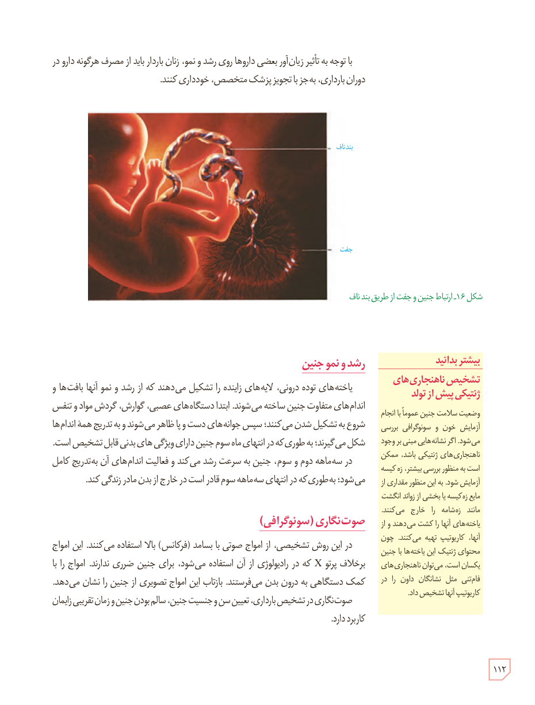

با توجه به تأثیر زیان‌آور بعضی داروها روی رشد و نمو، زنان باردار باید از مصرف هرگونه دارو در دوران بارداری، به جز با تجویز پزشک متخصص، خودداری کنند.

شکل ۱۶ـ ارتباط جنین و جفت از طریق بند ناف. برچسب‌ها: بند ناف، جفت.

## رشد و نمو جنین

یاخته‌های تودۀ درونی، لایه‌های زاینده را تشکیل می‌دهند که از رشد و نمو آنها بافت‌ها و اندام‌های متفاوت جنین ساخته می‌شوند. ابتدا دستگاه‌های عصبی، گوارش، گردش مواد و تنفس شروع به تشکیل شدن می‌کنند؛ سپس جوانه‌های دست و پا ظاهر می‌شوند و به تدریج همۀ اندام‌ها شکل می‌گیرند؛ به طوری که در انتهای ماه سوم جنین دارای ویژگی‌های بدنی قابل تشخیص است. در سه‌ماهۀ دوم و سوم، جنین به سرعت رشد می‌کند و فعالیت اندام‌های آن به‌تدریج کامل می‌شود؛ به طوری که در انتهای سه‌ماهۀ سوم قادر است در خارج از بدن مادر زندگی کند.

## صوت‌نگاری (سونوگرافی)

در این روش تشخیصی، از امواج صوتی با بسامد (فرکانس) بالا استفاده می‌کنند. این امواج برخلاف پرتو X که در رادیولوژی از آن استفاده می‌شود، برای جنین ضرری ندارند. امواج را با کمک دستگاهی به درون بدن می‌فرستند. بازتاب این امواج تصویری از جنین را نشان می‌دهد. صوت‌نگاری در تشخیص بارداری، تعیین سن و جنسیت جنین، سالم بودن جنین و زمان تقریبی زایمان کاربرد دارد.

### بیشتر بدانید: تشخیص ناهنجاری‌های ژنتیکی پیش از تولد

وضعیت سلامت جنین عموماً با انجام آزمایش خون و سونوگرافی بررسی می‌شود. اگر نشانه‌هایی مبنی بر وجود ناهنجاری‌های ژنتیکی باشد، ممکن است به منظور بررسی بیشتر، زه‌کیسه آزمایش شود. به این منظور مقداری از مایع زه‌کیسه یا بخشی از زوائد انگشت‌مانند زه‌شامه را خارج می‌کنند. یاخته‌های آنها را کشت می‌دهند و از آنها، کاریوتیپ تهیه می‌کنند. چون محتوای ژنتیکی این یاخته‌ها با جنین یکسان است، می‌توان ناهنجاری‌های فام‌تنی مثل نشانگان داون را در کاریوتیپ آنها تشخیص داد.

۱۱۲

