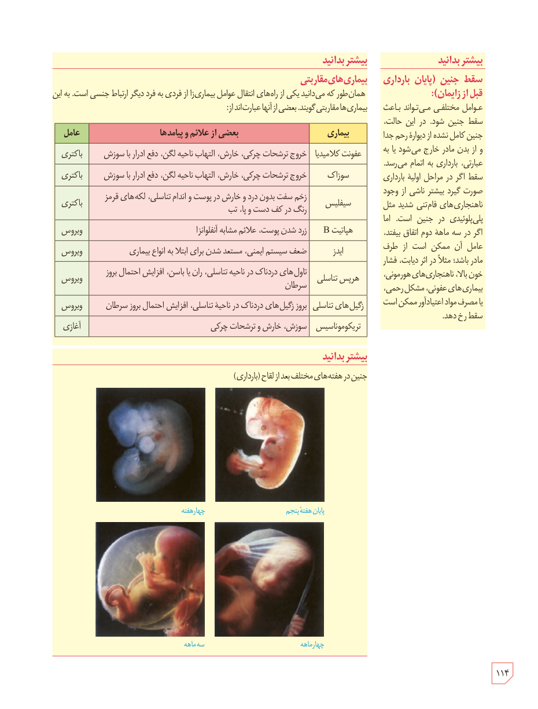

### بیشتر بدانید: بیماری‌های مقاربتی

همان‌طور که می‌دانید یکی از راه‌های انتقال عوامل بیماری‌زا از فردی به فرد دیگر ارتباط جنسی است. به این بیماری‌ها مقاربتی گویند. بعضی از آنها عبارت‌اند از:

| بیماری | بعضی از علائم و پیامدها | عامل |
|---|---|---|
| عفونت کلامیدیا | خروج ترشحات چرکی، خارش، التهاب ناحیۀ لگن، دفع ادرار با سوزش | باکتری |
| سوزاک | خروج ترشحات چرکی، خارش، التهاب ناحیۀ لگن، دفع ادرار با سوزش | باکتری |
| سیفلیس | زخم سفت بدون درد و خارش در پوست و اندام تناسلی، لکه‌های قرمز رنگ در کف دست و پا، تب | باکتری |
| هپاتیت B | زرد شدن پوست، علائم مشابه آنفلوآنزا | ویروس |
| ایدز | ضعف سیستم ایمنی، مستعد شدن برای ابتلا به انواع بیماری | ویروس |
| هرپس تناسلی | تاول‌های دردناک در ناحیۀ تناسلی، ران یا باسن، افزایش احتمال بروز سرطان | ویروس |
| زگیل‌های تناسلی | بروز زگیل‌های دردناک در ناحیۀ تناسلی، افزایش احتمال بروز سرطان | ویروس |
| تریکوموناسیس | سوزش، خارش و ترشحات چرکی | آغازی |

### بیشتر بدانید: سقط جنین (پایان بارداری قبل از زایمان)

عوامل مختلفی می‌تواند باعث سقط جنین شود. در این حالت، جنین کامل نشده از دیوارۀ رحم جدا و از بدن مادر خارج می‌شود یا به عبارتی، بارداری به اتمام می‌رسد. سقط اگر در مراحل اولیۀ بارداری صورت گیرد بیشتر ناشی از وجود ناهنجاری‌های فام‌تنی شدید مثل پلی‌پلوئیدی در جنین است. اما اگر در سه ماهۀ دوم اتفاق بیفتد، عامل آن ممکن است از طرف مادر باشد؛ مثلاً در اثر دیابت، فشار خون بالا، ناهنجاری‌های هورمونی، بیماری‌های عفونی، مشکل رحمی، یا مصرف مواد اعتیادآور ممکن است سقط رخ دهد.

### بیشتر بدانید

جنین در هفته‌های مختلف بعد از لقاح (بارداری): چهار هفته، پایان هفتۀ پنجم، سه ماهه، چهار ماهه.

۱۱۴

