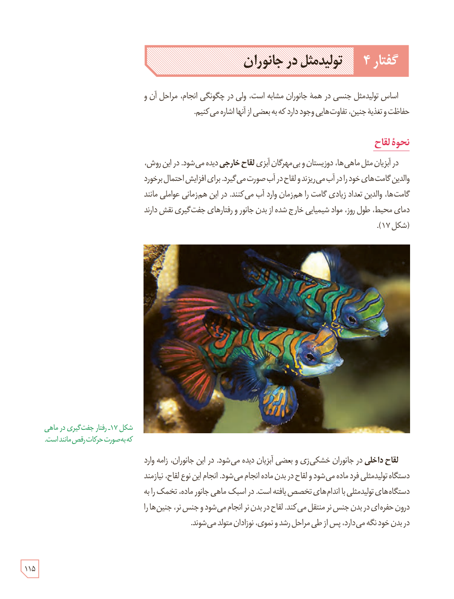

# گفتار ۴: تولیدمثل در جانوران

اساس تولیدمثل جنسی در همۀ جانوران مشابه است، ولی در چگونگی انجام، مراحل آن و حفاظت و تغذیۀ جنین، تفاوت‌هایی وجود دارد که به بعضی از آنها اشاره می‌کنیم.

## نحوۀ لقاح

در آبزیان مثل ماهی‌ها، دوزیستان و بی‌مهرگان آبزی **لقاح خارجی** دیده می‌شود. در این روش، والدین گامت‌های خود را در آب می‌ریزند و لقاح در آب صورت می‌گیرد. برای افزایش احتمال برخورد گامت‌ها، والدین تعداد زیادی گامت را هم‌زمان وارد آب می‌کنند. در این هم‌زمانی عواملی مانند دمای محیط، طول روز، مواد شیمیایی خارج شده از بدن جانور و رفتارهای جفت‌گیری نقش دارند (شکل ۱۷).

شکل ۱۷ـ رفتار جفت‌گیری در ماهی که به‌صورت حرکات رقص‌مانند است.

**لقاح داخلی** در جانوران خشکی‌زی و بعضی آبزیان دیده می‌شود. در این جانوران، زامه وارد دستگاه تولیدمثلی فرد ماده می‌شود و لقاح در بدن ماده انجام می‌شود. انجام این نوع لقاح، نیازمند دستگاه‌های تولیدمثلی با اندام‌های تخصص یافته است. در اسبک ماهی جانور ماده، تخمک را به درون حفره‌ای در بدن جنس نر منتقل می‌کند. لقاح در بدن نر انجام می‌شود و جنس نر، جنین‌ها را در بدن خود نگه می‌دارد. پس از طی مراحل رشد و نموی، نوزادان متولد می‌شوند.

۱۱۵

