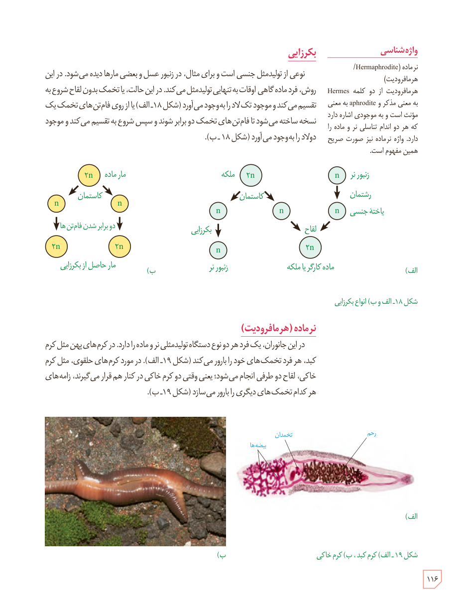

## بکرزایی

نوعی از تولیدمثل جنسی است و برای مثال، در زنبور عسل و بعضی مارها دیده می‌شود. در این روش، فرد ماده گاهی اوقات به تنهایی تولیدمثل می‌کند. در این حالت، یا تخمک بدون لقاح شروع به تقسیم می‌کند و موجود تک‌لاد را به‌وجود می‌آورد (شکل ۱۸ـ الف) یا از روی فام‌تن‌های تخمک یک نسخه ساخته می‌شود تا فام‌تن‌های تخمک دو برابر شوند و سپس شروع به تقسیم می‌کند و موجود دولاد را به‌وجود می‌آورد (شکل ۱۸ـ ب).

شکل ۱۸ـ الف و ب) انواع بکرزایی. برچسب‌ها: زنبور نر، رشتمان، یاختۀ جنسی، ملکه، کاستمان، لقاح، بکرزایی، مادۀ کارگر یا ملکه؛ مار ماده، دو برابر شدن فام‌تن‌ها، مار حاصل از بکرزایی.

## نرماده (هرمافرودیت)

در این جانوران، یک فرد هر دو نوع دستگاه تولیدمثلی نر و ماده را دارد. در کرم‌های پهن مثل کرم کبد، هر فرد تخمک‌های خود را بارور می‌کند (شکل ۱۹ـ الف). در مورد کرم‌های حلقوی، مثل کرم خاکی، لقاح دو طرفی انجام می‌شود؛ یعنی وقتی دو کرم خاکی در کنار هم قرار می‌گیرند، زامه‌های هر کدام تخمک‌های دیگری را بارور می‌سازد (شکل ۱۹ـ ب).

شکل ۱۹ـ الف) کرم کبد، ب) کرم خاکی. برچسب‌ها: رحم، تخمدان، بیضه‌ها.

### واژه‌شناسی

نرماده (Hermaphrodite/هرمافرودیت)

هرمافرودیت از دو کلمۀ Hermes به معنی مذکر و aphrodite به معنی مؤنث است و به موجودی اشاره دارد که هر دو اندام تناسلی نر و ماده را دارد. واژۀ نرماده نیز به‌صورت صریح همین مفهوم است.

۱۱۶

