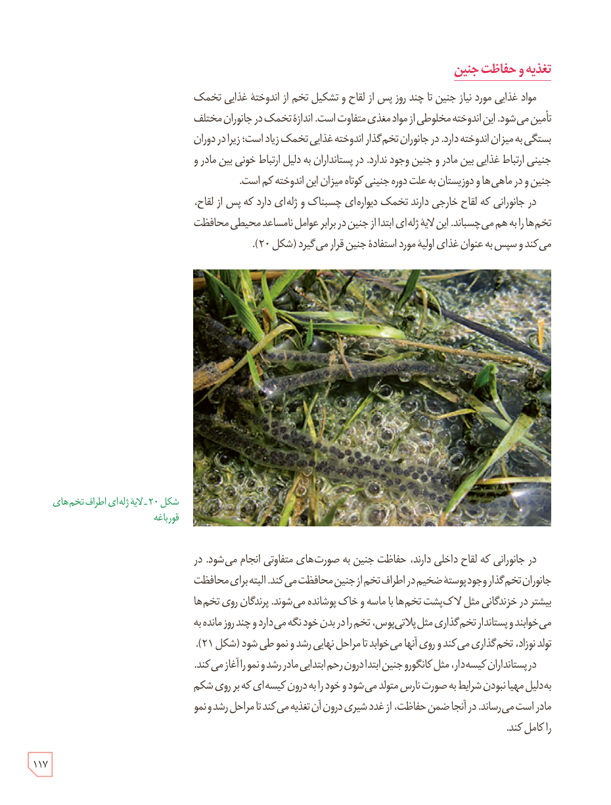

## تغذیه و حفاظت جنین

مواد غذایی مورد نیاز جنین تا چند روز پس از لقاح و تشکیل تخم از اندوختۀ غذایی تخمک تأمین می‌شود. این اندوخته مخلوطی از مواد مغذی متفاوت است. اندازۀ تخمک در جانوران مختلف بستگی به میزان اندوخته دارد. در جانوران تخم‌گذار اندوختۀ غذایی تخمک زیاد است؛ زیرا در دوران جنینی ارتباط غذایی بین مادر و جنین وجود ندارد. در پستانداران به دلیل ارتباط خونی بین مادر و جنین و در ماهی‌ها و دوزیستان به علت دورۀ جنینی کوتاه میزان این اندوخته کم است.

در جانورانی که لقاح خارجی دارند تخمک دیواره‌ای چسبناک و ژله‌ای دارد که پس از لقاح، تخم‌ها را به هم می‌چسباند. این لایۀ ژله‌ای ابتدا از جنین در برابر عوامل نامساعد محیطی محافظت می‌کند و سپس به عنوان غذای اولیه مورد استفادۀ جنین قرار می‌گیرد (شکل ۲۰).

شکل ۲۰ـ لایۀ ژله‌ای اطراف تخم‌های قورباغه

در جانورانی که لقاح داخلی دارند، حفاظت جنین به صورت‌های متفاوتی انجام می‌شود. در جانوران تخم‌گذار وجود پوستۀ ضخیم در اطراف تخم از جنین محافظت می‌کند. البته برای محافظت بیشتر در خزندگان مثل لاک‌پشت تخم‌ها با ماسه و خاک پوشانده می‌شوند. پرندگان روی تخم‌ها می‌خوابند و پستاندار تخم‌گذاری مثل پلاتی‌پوس، تخم را در بدن خود نگه می‌دارد و چند روز مانده به تولد نوزاد، تخم‌گذاری می‌کند و روی آنها می‌خوابد تا مراحل نهایی رشد و نمو طی شود (شکل ۲۱).

در پستانداران کیسه‌دار، مثل کانگورو جنین ابتدا درون رحم ابتدایی مادر رشد و نمو را آغاز می‌کند. به‌دلیل مهیا نبودن شرایط به صورت نارس متولد می‌شود و خود را به درون کیسه‌ای که بر روی شکم مادر است می‌رساند. در آنجا ضمن حفاظت، از غدد شیری درون آن تغذیه می‌کند تا مراحل رشد و نمو را کامل کند.

۱۱۷

