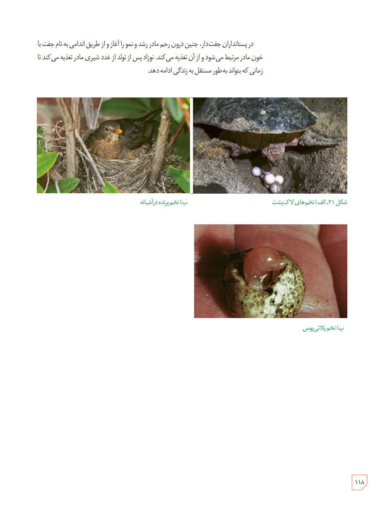

در پستانداران جفت‌دار، جنین درون رحم مادر رشد و نمو را آغاز و از طریق اندامی به نام جفت با خون مادر مرتبط می‌شود و از آن تغذیه می‌کند. نوزاد پس از تولد از غدد شیری مادر تغذیه می‌کند تا زمانی که بتواند به‌طور مستقل به زندگی ادامه دهد.

شکل ۲۱ـ الف) تخم‌های لاک‌پشت؛ ب) تخم پرنده در آشیانه؛ پ) تخم پلاتی‌پوس

۱۱۸

