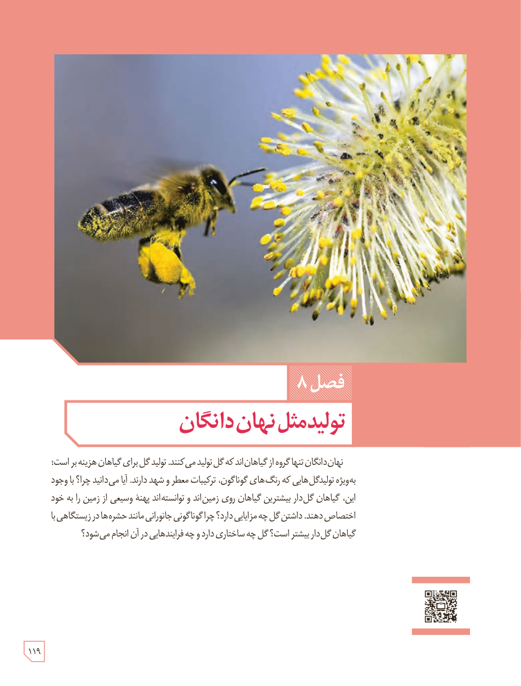

# فصل ۸: تولیدمثل نهان‌دانگان

نهان‌دانگان تنها گروه از گیاهان‌اند که گل تولید می‌کنند. تولید گل برای گیاهان هزینه‌بر است؛ به‌ویژه تولید گل‌هایی که رنگ‌های گوناگون، ترکیبات معطر و شهد دارند. آیا می‌دانید چرا؟ با وجود این، گیاهان گل‌دار بیشترین گیاهان روی زمین‌اند و توانسته‌اند پهنۀ وسیعی از زمین را به خود اختصاص دهند. داشتن گل چه مزایایی دارد؟ چرا گوناگونی جانورانی مانند حشره‌ها در زیستگاه‌هایی با گیاهان گل‌دار بیشتر است؟ گل چه ساختاری دارد و چه فرایندهایی در آن انجام می‌شود؟

۱۱۹

