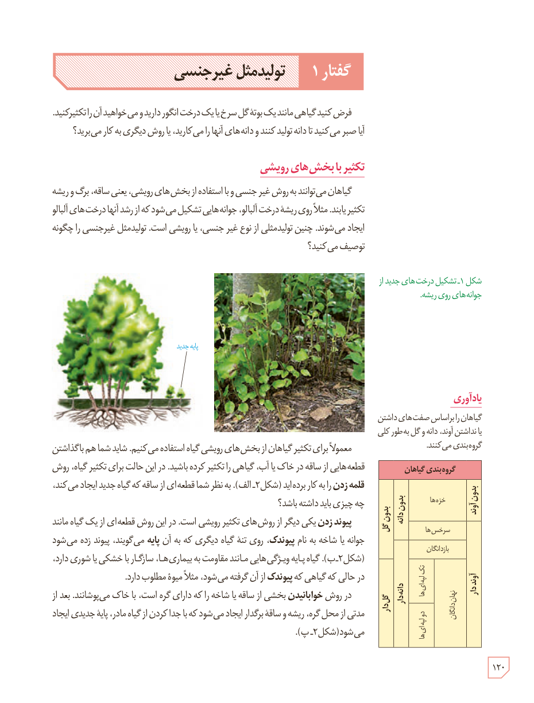

# گفتار ۱: تولیدمثل غیرجنسی

فرض کنید گیاهی مانند یک بوتۀ گل سرخ یا یک درخت انگور دارید و می‌خواهید آن را تکثیر کنید. آیا صبر می‌کنید تا دانه تولید کنند و دانه‌های آنها را می‌کارید، یا روش دیگری به کار می‌برید؟

## تکثیر با بخش‌های رویشی

گیاهان می‌توانند به روش غیرجنسی و با استفاده از بخش‌های رویشی، یعنی ساقه، برگ و ریشه تکثیر یابند. مثلاً روی ریشۀ درخت آلبالو، جوانه‌هایی تشکیل می‌شود که از رشد آنها درخت‌های آلبالو ایجاد می‌شوند. چنین تولیدمثلی از نوع غیرجنسی، یا رویشی است. تولیدمثل غیرجنسی را چگونه توصیف می‌کنید؟

شکل ۱ـ تشکیل درخت‌های جدید از جوانه‌های روی ریشه. برچسب: پایۀ جدید.

معمولاً برای تکثیر گیاهان از بخش‌های رویشی گیاه استفاده می‌کنیم. شاید شما هم با گذاشتن قطعه‌هایی از ساقه در خاک یا آب، گیاهی را تکثیر کرده باشید. در این حالت برای تکثیر گیاه، روش **قلمه زدن** را به کار برده‌اید (شکل ۲ـ الف). به نظر شما قطعه‌ای از ساقه که گیاه جدید ایجاد می‌کند، چه چیزی باید داشته باشد؟

**پیوند زدن** یکی دیگر از روش‌های تکثیر رویشی است. در این روش قطعه‌ای از یک گیاه مانند جوانه یا شاخه به نام **پیوندک**، روی تنۀ گیاه دیگری که به آن **پایه** می‌گویند، پیوند زده می‌شود (شکل ۲ـ ب). گیاه پایه ویژگی‌هایی مانند مقاومت به بیماری‌ها، سازگار با خشکی یا شوری دارد، در حالی که گیاهی که پیوندک از آن گرفته می‌شود، مثلاً میوۀ مطلوب دارد.

در روش **خوابانیدن** بخشی از ساقه یا شاخه را که دارای گره است، با خاک می‌پوشانند. بعد از مدتی از محل گره، ریشه و ساقۀ برگ‌دار ایجاد می‌شود که با جدا کردن از گیاه مادر، پایۀ جدیدی ایجاد می‌شود (شکل ۲ـ پ).

### یادآوری

گیاهان را براساس صفت‌های داشتن یا نداشتن آوند، دانه و گل به‌طور کلی گروه‌بندی می‌کنند.

گروه‌بندی گیاهان: بدون آوند: خزه‌ها؛ آونددار و بدون دانه: سرخس‌ها؛ آونددار و دانه‌دار: بازدانگان و نهان‌دانگان (تک‌لپه‌ای‌ها و دولپه‌ای‌ها). بدون گل و گل‌دار.

۱۲۰

