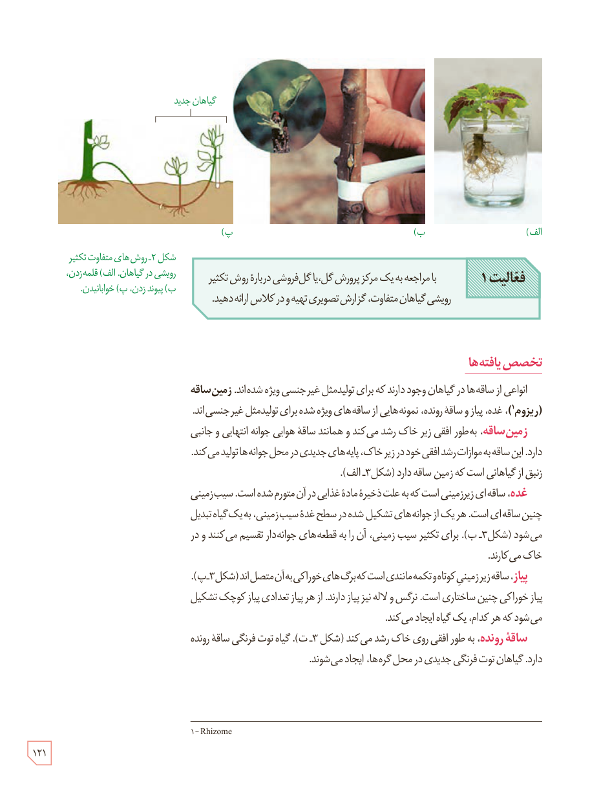

شکل ۲ـ روش‌های متفاوت تکثیر رویشی در گیاهان. الف) قلمه زدن، ب) پیوند زدن، پ) خوابانیدن. برچسب: گیاهان جدید.

**فعالیت ۱**

با مراجعه به یک مرکز پرورش گل، یا گل‌فروشی دربارۀ روش تکثیر رویشی گیاهان متفاوت، گزارش تصویری تهیه و در کلاس ارائه دهید.

## تخصص‌یافته‌ها

انواعی از ساقه‌ها در گیاهان وجود دارند که برای تولیدمثل غیرجنسی ویژه شده‌اند. **زمین‌ساقه (ریزوم)¹**، غده، پیاز و ساقۀ رونده، نمونه‌هایی از ساقه‌های ویژه شده برای تولیدمثل غیرجنسی‌اند.

**زمین‌ساقه،** به‌طور افقی زیر خاک رشد می‌کند و همانند ساقۀ هوایی جوانه انتهایی و جانبی دارد. این ساقه به موازات رشد افقی خود در زیر خاک، پایه‌های جدیدی در محل جوانه‌ها تولید می‌کند. زنبق از گیاهانی است که زمین‌ساقه دارد (شکل ۳ـ الف).

**غده،** ساقه‌ای زیرزمینی است که به علت ذخیرۀ مادۀ غذایی در آن متورم شده است. سیب‌زمینی چنین ساقه‌ای است. هر یک از جوانه‌های تشکیل شده در سطح غدۀ سیب‌زمینی، به یک گیاه تبدیل می‌شود (شکل ۳ـ ب). برای تکثیر سیب‌زمینی، آن را به قطعه‌های جوانه‌دار تقسیم می‌کنند و در خاک می‌کارند.

**پیاز،** ساقۀ زیرزمینی کوتاه و تکمه‌مانندی است که برگ‌های خوراکی به آن متصل‌اند (شکل ۳ـ پ). پیاز خوراکی چنین ساختاری است. نرگس و لاله نیز پیاز دارند. از هر پیاز تعدادی پیاز کوچک تشکیل می‌شود که هر کدام، یک گیاه ایجاد می‌کند.

**ساقۀ رونده،** به طور افقی روی خاک رشد می‌کند (شکل ۳ـ ت). گیاه توت‌فرنگی ساقۀ رونده دارد. گیاهان توت‌فرنگی جدیدی در محل گره‌ها، ایجاد می‌شوند.

۱ـ Rhizome

۱۲۱

