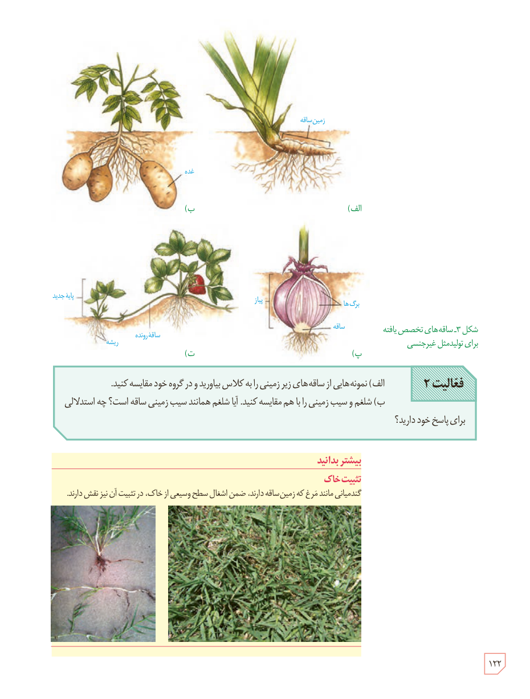

شکل ۳ـ ساقه‌های تخصص‌یافته برای تولیدمثل غیرجنسی. برچسب‌ها: الف) زمین‌ساقه؛ ب) غده؛ پ) پیاز، برگ‌ها، ساقه؛ ت) پایۀ جدید، ساقۀ رونده، ریشه.

**فعالیت ۲**

الف) نمونه‌هایی از ساقه‌های زیرزمینی را به کلاس بیاورید و در گروه خود مقایسه کنید.

ب) شلغم و سیب‌زمینی را با هم مقایسه کنید. آیا شلغم همانند سیب‌زمینی ساقه است؟ چه استدلالی برای پاسخ خود دارید؟

### بیشتر بدانید: تثبیت خاک

گندمیانی مانند مرغ که زمین‌ساقه دارند، ضمن اشغال سطح وسیعی از خاک، در تثبیت آن نیز نقش دارند.

۱۲۲

