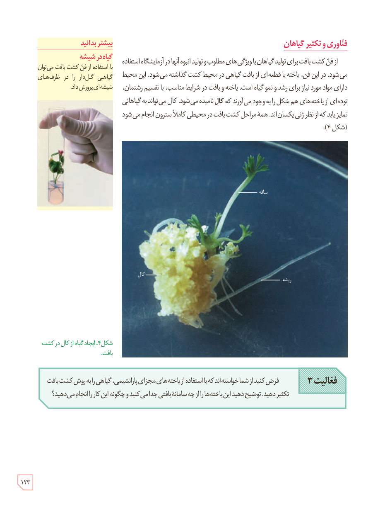

## فناوری و تکثیر گیاهان

از فن کشت بافت برای تولید گیاهان با ویژگی‌های مطلوب و تولید انبوه آنها در آزمایشگاه استفاده می‌شود. در این فن، یاخته یا قطعه‌ای از بافت گیاهی در محیط کشت گذاشته می‌شود. این محیط دارای مواد مورد نیاز برای رشد و نمو گیاه است. یاخته و بافت در شرایط مناسب، با تقسیم رشتمان، توده‌ای از یاخته‌های هم‌شکل را به وجود می‌آورند که **کال** نامیده می‌شود. کال می‌تواند به گیاهانی تمایز یابد که از نظر ژنی یکسان‌اند. همۀ مراحل کشت بافت در محیطی کاملاً سترون انجام می‌شود (شکل ۴).

شکل ۴ـ ایجاد گیاه از کال در کشت بافت. برچسب‌ها: ساقه، کال، ریشه.

**فعالیت ۳**

فرض کنید از شما خواسته‌اند که با استفاده از یاخته‌های مجزای پارانشیمی، گیاهی را به روش کشت بافت تکثیر دهید. توضیح دهید این یاخته‌ها را از چه سامانۀ بافتی جدا می‌کنید و چگونه این کار را انجام می‌دهید؟

### بیشتر بدانید: گیاه در شیشه

با استفاده از فن کشت بافت می‌توان گیاهی گل‌دار را در ظرف‌های شیشه‌ای پرورش داد.

۱۲۳

