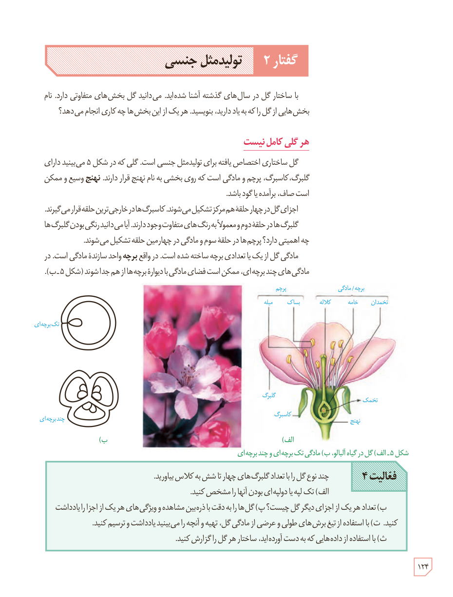

# گفتار ۲: تولیدمثل جنسی

با ساختار گل در سال‌های گذشته آشنا شده‌اید. می‌دانید گل بخش‌های متفاوتی دارد. نام بخش‌هایی از گل را که به یاد دارید، بنویسید. هر یک از این بخش‌ها چه کاری انجام می‌دهد؟

## هر گلی کامل نیست

گل ساختاری اختصاص یافته برای تولیدمثل جنسی است. گلی که در شکل ۵ می‌بینید دارای گلبرگ، کاسبرگ، پرچم و مادگی است که روی بخشی به نام نهنج قرار دارند. نهنج وسیع و ممکن است صاف، برآمده یا گود باشد.

اجزای گل در چهار حلقۀ هم‌مرکز تشکیل می‌شوند. کاسبرگ‌ها در خارجی‌ترین حلقه قرار می‌گیرند. گلبرگ‌ها در حلقۀ دوم و معمولاً به رنگ‌های متفاوت وجود دارند. آیا می‌دانید رنگی بودن گلبرگ‌ها چه اهمیتی دارد؟ پرچم‌ها در حلقۀ سوم و مادگی در چهارمین حلقه تشکیل می‌شوند.

مادگی گل از یک یا تعدادی برچه ساخته شده است. در واقع **برچه** واحد سازندۀ مادگی است. در مادگی‌های چند برچه‌ای، ممکن است فضای مادگی با دیوارۀ برچه‌ها از هم جدا شوند (شکل ۵ـ ب).

شکل ۵ـ الف) گل در گیاه آلبالو، ب) مادگی تک‌برچه‌ای و چندبرچه‌ای. برچسب‌ها: پرچم، میله، بساک، برچه/مادگی، کلاله، خامه، تخمدان، گلبرگ، تخمک، کاسبرگ، نهنج.

**فعالیت ۴**

چند نوع گل را با تعداد گلبرگ‌های چهار تا شش به کلاس بیاورید.

الف) تک‌لپه یا دولپه‌ای بودن آنها را مشخص کنید.

ب) تعداد هر یک از اجزای دیگر گل چیست؟ پ) گل‌ها را به دقت با ذره‌بین مشاهده و ویژگی‌های هر یک از اجزا را یادداشت کنید. ت) با استفاده از تیغ برش‌های طولی و عرضی از مادگی گل، تهیه و آنچه را می‌بینید یادداشت و ترسیم کنید.

ث) با استفاده از داده‌هایی که به دست آورده‌اید، ساختار هر گل را گزارش کنید.

۱۲۴

