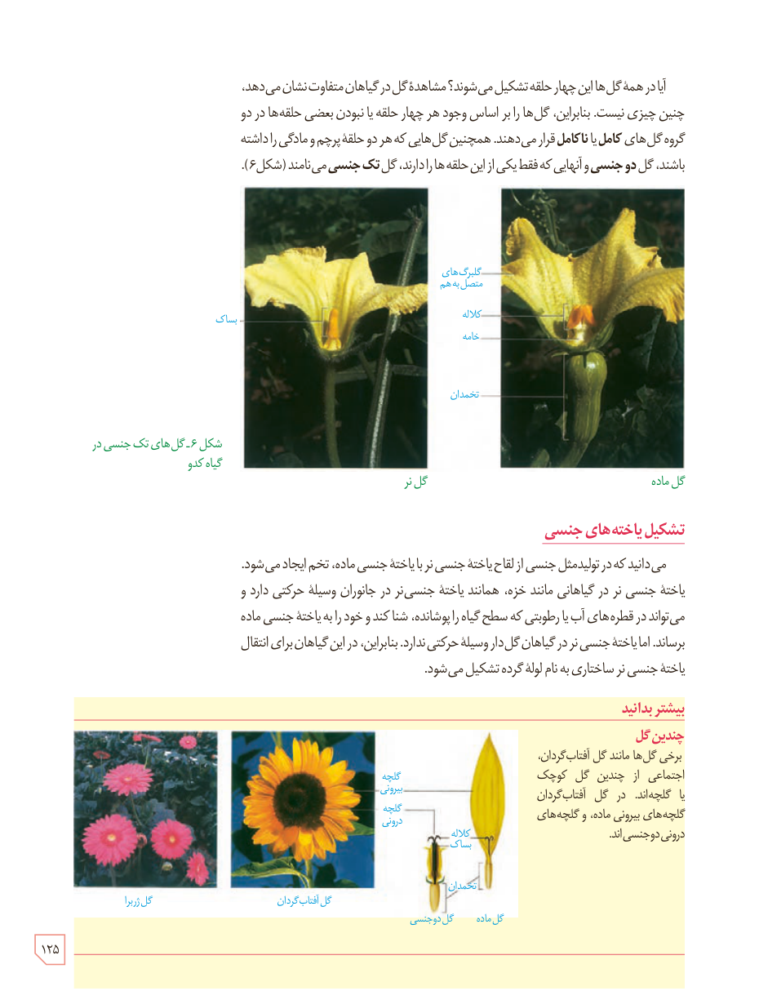

آیا در همۀ گل‌ها این چهار حلقه تشکیل می‌شوند؟ مشاهدۀ گل در گیاهان متفاوت نشان می‌دهد، چنین چیزی نیست. بنابراین، گل‌ها را بر اساس وجود هر چهار حلقه یا نبودن بعضی حلقه‌ها در دو گروه گل‌های **کامل** یا **نا کامل** قرار می‌دهند. همچنین گل‌هایی که هر دو حلقۀ پرچم و مادگی را داشته باشند، گل **دو جنسی** و آنهایی که فقط یکی از این حلقه‌ها را دارند، گل **تک جنسی** می‌نامند (شکل ۶).

شکل ۶ـ گل‌های تک جنسی در گیاه کدو. برچسب‌ها: گل نر، گل ماده، بساک، گلبرگ‌های متصل به هم، کلاله، خامه، تخمدان.

## تشکیل یاخته‌های جنسی

می‌دانید که در تولیدمثل جنسی از لقاح یاختۀ جنسی نر با یاختۀ جنسی ماده، تخم ایجاد می‌شود. یاختۀ جنسی نر در گیاهانی مانند خزه، همانند یاختۀ جنسی نر در جانوران وسیلۀ حرکتی دارد و می‌تواند در قطره‌های آب یا رطوبتی که سطح گیاه را پوشانده، شنا کند و خود را به یاختۀ جنسی ماده برساند. اما یاختۀ جنسی نر در گیاهان گل‌دار وسیلۀ حرکتی ندارد. بنابراین، در این گیاهان برای انتقال یاختۀ جنسی نر ساختاری به نام لولۀ گرده تشکیل می‌شود.

### بیشتر بدانید: چندین گل

برخی گل‌ها مانند گل آفتاب‌گردان، اجتماعی از چندین گل کوچک یا گلچه‌اند. در گل آفتاب‌گردان گلچه‌های بیرونی ماده، و گلچه‌های درونی دوجنسی‌اند.

برچسب‌ها: گل ژربرا، گل آفتاب‌گردان، گلچۀ بیرونی، گلچۀ درونی، کلاله، بساک، تخمدان، گل ماده، گل دوجنسی.

۱۲۵

