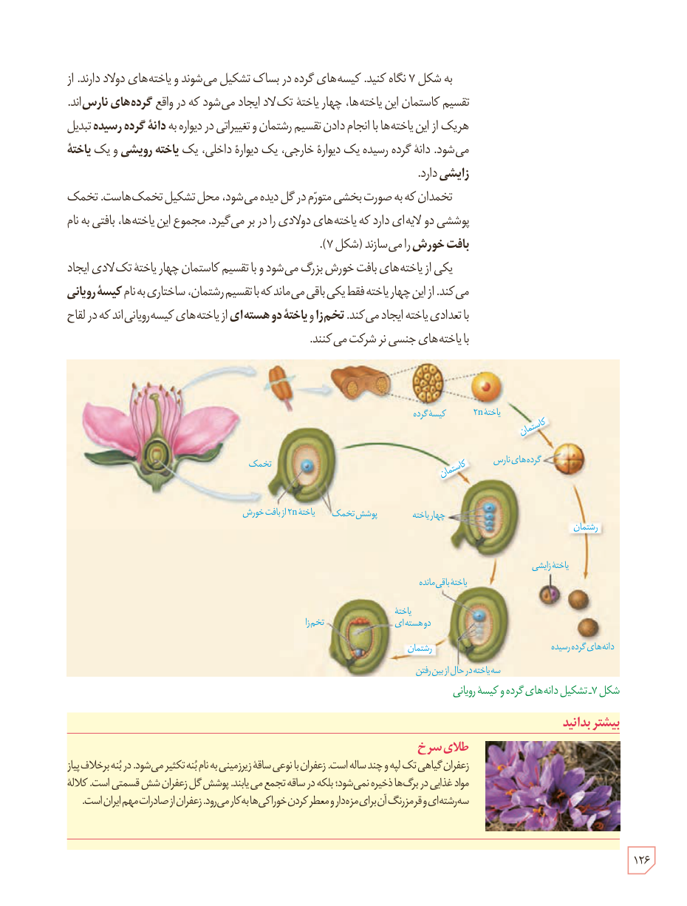

به شکل ۷ نگاه کنید. کیسه‌های گرده در بساک تشکیل می‌شوند و یاخته‌های دولاد دارند. از تقسیم کاستمان این یاخته‌ها، چهار یاختۀ تک‌لاد ایجاد می‌شود که در واقع **گرده‌های نارس**‌اند. هریک از این یاخته‌ها با انجام دادن تقسیم رشتمان و تغییراتی در دیواره به **دانۀ گردۀ رسیده** تبدیل می‌شود. دانۀ گردۀ رسیده یک دیوارۀ خارجی، یک دیوارۀ داخلی، یک **یاختۀ رویشی** و یک **یاختۀ زایشی** دارد.

تخمدان که به صورت بخشی متورم در گل دیده می‌شود، محل تشکیل تخمک‌هاست. تخمک پوششی دو لایه‌ای دارد که یاخته‌های دولادی را در بر می‌گیرد. مجموع این یاخته‌ها، بافتی به نام **بافت خورش** را می‌سازند (شکل ۷).

یکی از یاخته‌های بافت خورش بزرگ می‌شود و با تقسیم کاستمان چهار یاختۀ تک‌لادی ایجاد می‌کند. از این چهار یاخته فقط یکی باقی می‌ماند که با تقسیم رشتمان، ساختاری به نام **کیسۀ رویانی** با تعدادی یاخته ایجاد می‌کند. **تخم‌زا** و **یاختۀ دو هسته‌ای** از یاخته‌های کیسۀ رویانی‌اند که در لقاح با یاخته‌های جنسی نر شرکت می‌کنند.

شکل ۷ـ تشکیل دانه‌های گرده و کیسۀ رویانی. برچسب‌ها: کیسۀ گرده، یاختۀ ۲n، کاستمان، گرده‌های نارس، رشتمان، یاختۀ زایشی، دانه‌های گردۀ رسیده، تخمک، پوشش تخمک، یاختۀ ۲n از بافت خورش، چهار یاخته، یاختۀ باقی‌مانده، سه یاخته در حال از بین رفتن، یاختۀ دو هسته‌ای، تخم‌زا.

### بیشتر بدانید: طلای سرخ

زعفران گیاهی تک‌لپه و چندساله است. زعفران با نوعی ساقۀ زیرزمینی به نام بنه تکثیر می‌شود. در بنه برخلاف پیاز مواد غذایی در برگ‌ها ذخیره نمی‌شود؛ بلکه در ساقه تجمع می‌یابند. پوشش گل زعفران شش قسمتی است. کلالۀ سه‌رشته‌ای و قرمزرنگ آن برای مزه‌دار و معطر کردن خوراکی‌ها به کار می‌رود. زعفران از صادرات مهم ایران است.

۱۲۶

