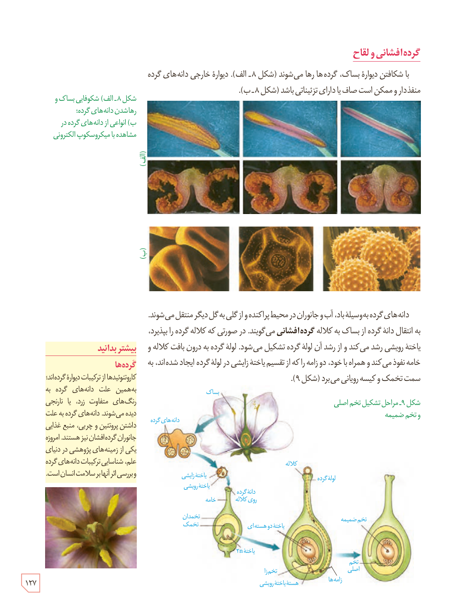

## گرده‌افشانی و لقاح

با شکافتن دیوارۀ بساک، گرده‌ها رها می‌شوند (شکل ۸ـ الف). دیوارۀ خارجی دانه‌های گرده منفذدار و ممکن است صاف یا دارای تزییناتی باشد (شکل ۸ـ ب).

شکل ۸ـ الف) شکوفایی بساک و رها شدن دانه‌های گرده؛ ب) انواعی از دانه‌های گرده در مشاهده با میکروسکوپ الکترونی

دانه‌های گرده به‌وسیلۀ باد، آب و جانوران در محیط پراکنده و از گلی به گل دیگر منتقل می‌شوند. به انتقال دانۀ گرده از بساک به کلاله **گرده‌افشانی** می‌گویند. در صورتی که کلاله گرده را بپذیرد، یاختۀ رویشی رشد می‌کند و از رشد آن لولۀ گرده تشکیل می‌شود. لولۀ گرده به درون بافت کلاله و خامه نفوذ می‌کند و همراه با خود، دو زامه را که از تقسیم یاختۀ زایشی در لولۀ گرده ایجاد شده‌اند، به سمت تخمک و کیسۀ رویانی می‌برد (شکل ۹).

شکل ۹ـ مراحل تشکیل تخم اصلی و تخم ضمیمه. برچسب‌ها: بساک، دانه‌های گرده، یاختۀ زایشی، یاختۀ رویشی، دانۀ گرده روی کلاله، خامه، تخمدان، تخمک، یاختۀ ۲n، کلاله، لولۀ گرده، یاختۀ دو هسته‌ای، تخم ضمیمه، تخم اصلی، تخم‌زا، زامه‌ها، هستۀ یاختۀ رویشی.

### بیشتر بدانید: گرده‌ها

کاروتنوئیدها از ترکیبات دیوارۀ گرده‌اند؛ به‌همین علت دانه‌های گرده به رنگ‌های متفاوت زرد، یا نارنجی دیده می‌شوند. دانه‌های گرده به علت داشتن پروتئین و چربی، منبع غذایی جانوران گرده‌افشان نیز هستند. امروزه یکی از زمینه‌های پژوهشی در دنیای علم، شناسایی ترکیبات دانه‌های گرده و بررسی اثر آنها بر سلامت انسان است.

۱۲۷

