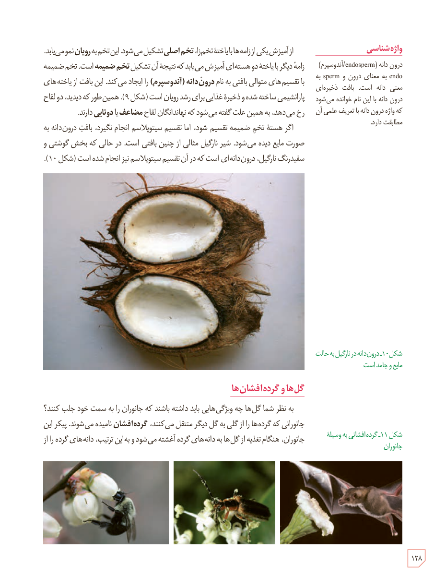

از آمیزش یکی از زامه‌ها با یاختۀ تخم‌زا، **تخم اصلی** تشکیل می‌شود. این تخم به **رویان** نمو می‌یابد. زامۀ دیگر با یاختۀ دو هسته‌ای آمیزش می‌یابد که نتیجۀ آن تشکیل **تخم ضمیمه** است. تخم ضمیمه با تقسیم‌های متوالی بافتی به نام **درون‌دانه (آندوسپرم)** را ایجاد می‌کند. این بافت از یاخته‌های پارانشیمی ساخته شده و ذخیرۀ غذایی برای رشد رویان است (شکل ۹). همین‌طور که دیدید، دو لقاح رخ می‌دهد، به همین علت گفته می‌شود که نهان‌دانگان لقاح **مضاعف** یا **دوتایی** دارند.

اگر هستۀ تخم ضمیمه تقسیم شود، اما تقسیم سیتوپلاسم انجام نگیرد، بافت درون‌دانه به صورت مایع دیده می‌شود. شیر نارگیل مثالی از چنین بافتی است. در حالی که بخش گوشتی و سفیدرنگ نارگیل، درون‌دانه‌ای است که در آن تقسیم سیتوپلاسم نیز انجام شده است (شکل ۱۰).

شکل ۱۰ـ درون‌دانه در نارگیل به حالت مایع و جامد است.

### واژه‌شناسی

درون‌دانه (endosperm/آندوسپرم)

endo به معنای درون و sperm به معنی دانه است. بافت ذخیره‌ای درون دانه با این نام خوانده می‌شود که واژۀ درون‌دانه با تعریف علمی آن مطابقت دارد.

## گل‌ها و گرده‌افشان‌ها

به نظر شما گل‌ها چه ویژگی‌هایی باید داشته باشند که جانوران را به سمت خود جلب کنند؟ جانورانی که گرده‌ها را از گلی به گل دیگر منتقل می‌کنند، **گرده‌افشان** نامیده می‌شوند. پیکر این جانوران، هنگام تغذیه از گل‌ها به دانه‌های گرده آغشته می‌شود و به این ترتیب، دانه‌های گرده را از

شکل ۱۱ـ گرده‌افشانی به‌وسیلۀ جانوران

۱۲۸

