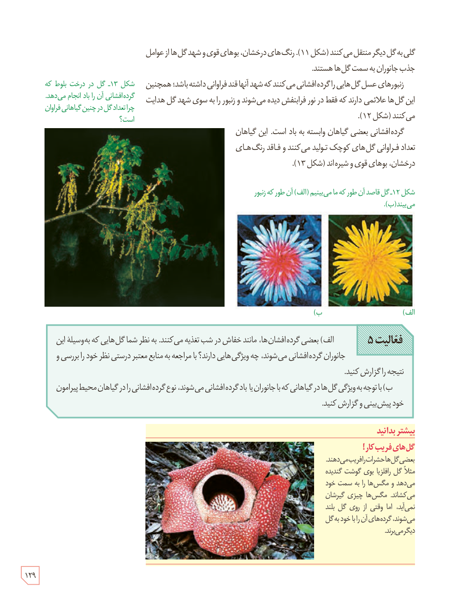

گلی به گل دیگر منتقل می‌کنند (شکل ۱۱). رنگ‌های درخشان، بوهای قوی و شهد گل‌ها از عوامل جذب جانوران به سمت گل‌ها هستند.

زنبورهای عسل گل‌هایی را گرده‌افشانی می‌کنند که شهد آنها قند فراوانی داشته باشد؛ همچنین این گل‌ها علائمی دارند که فقط در نور فرابنفش دیده می‌شوند و زنبور را به سوی شهد گل هدایت می‌کنند (شکل ۱۲).

گرده‌افشانی بعضی گیاهان وابسته به باد است. این گیاهان تعداد فراوانی گل‌های کوچک تولید می‌کنند و فاقد رنگ‌های درخشان، بوهای قوی و شیره‌اند (شکل ۱۳).

شکل ۱۲ـ گل قاصد آن‌طور که ما می‌بینیم (الف) آن طور که زنبور می‌بیند (ب).

شکل ۱۳ـ گل در درخت بلوط که گرده‌افشانی آن را باد انجام می‌دهد. چرا تعداد گل در چنین گیاهانی فراوان است؟

**فعالیت ۵**

الف) بعضی گرده‌افشان‌ها، مانند خفاش در شب تغذیه می‌کنند. به نظر شما گل‌هایی که به‌وسیلۀ این جانوران گرده‌افشانی می‌شوند، چه ویژگی‌هایی دارند؟ با مراجعه به منابع معتبر درستی نظر خود را بررسی و نتیجه را گزارش کنید.

ب) با توجه به ویژگی گل‌ها در گیاهانی که با جانوران یا باد گرده‌افشانی می‌شوند، نوع گرده‌افشانی را در گیاهان محیط پیرامون خود پیش‌بینی و گزارش کنید.

### بیشتر بدانید: گل‌های فریب‌کار!

بعضی گل‌ها حشرات را فریب می‌دهند. مثلاً گل رافلزیا بوی گوشت گندیده می‌دهد و مگس‌ها را به سمت خود می‌کشاند. مگس‌ها چیزی گیرشان نمی‌آید، اما وقتی از روی گل بلند می‌شوند، گرده‌های آن را با خود به گل دیگر می‌برند.

۱۲۹

