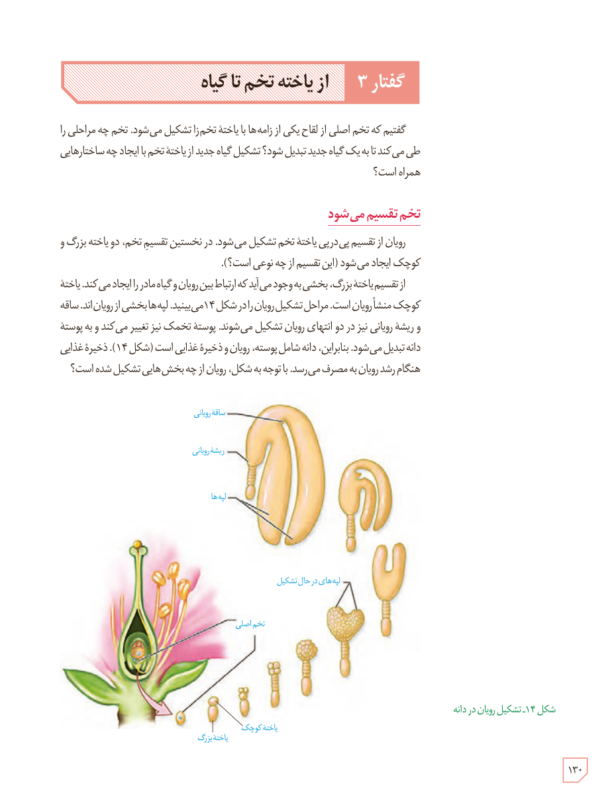

# گفتار ۳: از یاختۀ تخم تا گیاه

گفتیم که تخم اصلی از لقاح یکی از زامه‌ها با یاختۀ تخم‌زا تشکیل می‌شود. تخم چه مراحلی را طی می‌کند تا به یک گیاه جدید تبدیل شود؟ تشکیل گیاه جدید از یاختۀ تخم با ایجاد چه ساختارهایی همراه است؟

## تخم تقسیم می‌شود

رویان از تقسیم پی‌درپی یاختۀ تخم تشکیل می‌شود. در نخستین تقسیم تخم، دو یاختۀ بزرگ و کوچک ایجاد می‌شود (این تقسیم از چه نوعی است؟).

از تقسیم یاختۀ بزرگ، بخشی به وجود می‌آید که ارتباط بین رویان و گیاه مادر را ایجاد می‌کند. یاختۀ کوچک منشأ رویان است. مراحل تشکیل رویان را در شکل ۱۴ می‌بینید. لپه‌ها بخشی از رویان‌اند. ساقه و ریشۀ رویانی نیز در دو انتهای رویان تشکیل می‌شوند. پوستۀ تخمک نیز تغییر می‌کند و به پوستۀ دانه تبدیل می‌شود. بنابراین، دانه شامل پوسته، رویان و ذخیرۀ غذایی است (شکل ۱۴). ذخیرۀ غذایی هنگام رشد رویان به مصرف می‌رسد. با توجه به شکل، رویان از چه بخش‌هایی تشکیل شده است؟

شکل ۱۴ـ تشکیل رویان در دانه. برچسب‌ها: ساقۀ رویانی، ریشۀ رویانی، لپه‌ها، لپه‌های در حال تشکیل، تخم اصلی، یاختۀ کوچک، یاختۀ بزرگ.

۱۳۰

