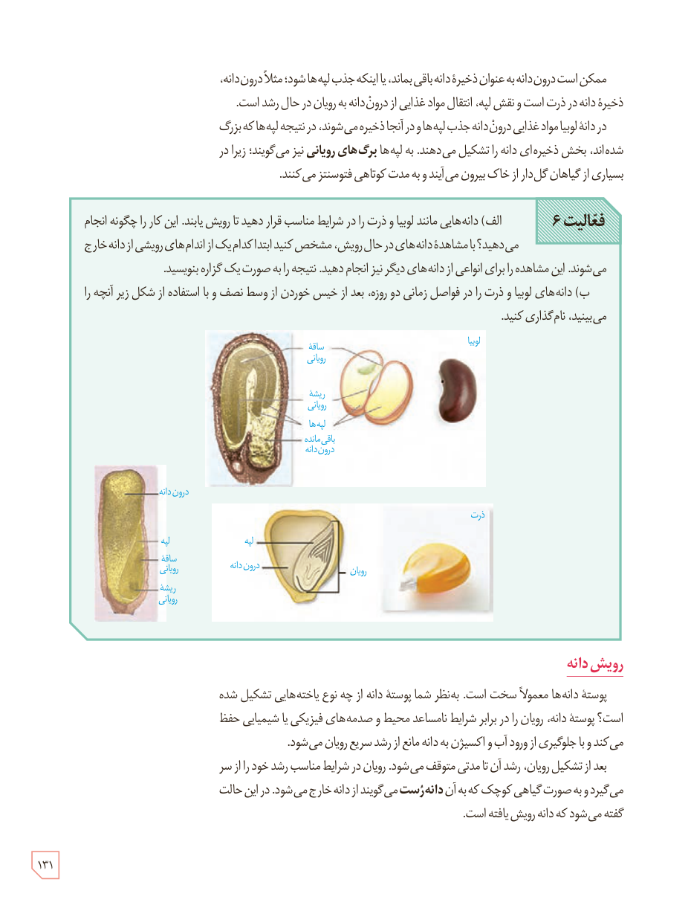

ممکن است درون‌دانه به عنوان ذخیرۀ دانه باقی بماند، یا اینکه جذب لپه‌ها شود؛ مثلاً درون‌دانه، ذخیرۀ دانه در ذرت است و نقش لپه، انتقال مواد غذایی از درون‌دانه به رویان در حال رشد است.

در دانۀ لوبیا مواد غذایی درون‌دانه جذب لپه‌ها و در آنجا ذخیره می‌شوند، در نتیجه لپه‌ها که بزرگ شده‌اند، بخش ذخیره‌ای دانه را تشکیل می‌دهند. به لپه‌ها **برگ‌های رویانی** نیز می‌گویند؛ زیرا در بسیاری از گیاهان گل‌دار از خاک بیرون می‌آیند و به مدت کوتاهی فتوسنتز می‌کنند.

**فعالیت ۶**

الف) دانه‌هایی مانند لوبیا و ذرت را در شرایط مناسب قرار دهید تا رویش یابند. این کار را چگونه انجام می‌دهید؟ با مشاهدۀ دانه‌های در حال رویش، مشخص کنید ابتدا کدام‌یک از اندام‌های رویشی از دانه خارج می‌شوند. این مشاهده را برای انواعی از دانه‌های دیگر نیز انجام دهید. نتیجه را به صورت یک گزارش بنویسید.

ب) دانه‌های لوبیا و ذرت را در فواصل زمانی دو روزه، بعد از خیس خوردن از وسط نصف و با استفاده از شکل زیر آنچه را می‌بینید، نام‌گذاری کنید.

برچسب‌های شکل: لوبیا، ساقۀ رویانی، ریشۀ رویانی، لپه‌ها، باقی‌ماندۀ درون‌دانه؛ ذرت، درون‌دانه، لپه، ساقۀ رویانی، ریشۀ رویانی، رویان.

## رویش دانه

پوستۀ دانه‌ها معمولاً سخت است. به نظر شما پوستۀ دانه از چه نوع یاخته‌هایی تشکیل شده است؟ پوستۀ دانه، رویان را در برابر شرایط نامساعد محیط و صدمه‌های فیزیکی یا شیمیایی حفظ می‌کند و با جلوگیری از ورود آب و اکسیژن به دانه مانع از رشد سریع رویان می‌شود.

بعد از تشکیل رویان، رشد آن تا مدتی متوقف می‌شود. رویان در شرایط مناسب رشد خود را از سر می‌گیرد و به صورت گیاهی کوچک که به آن **دانه‌رست** می‌گویند از دانه خارج می‌شود. در این حالت گفته می‌شود که دانه رویش یافته است.

۱۳۱

