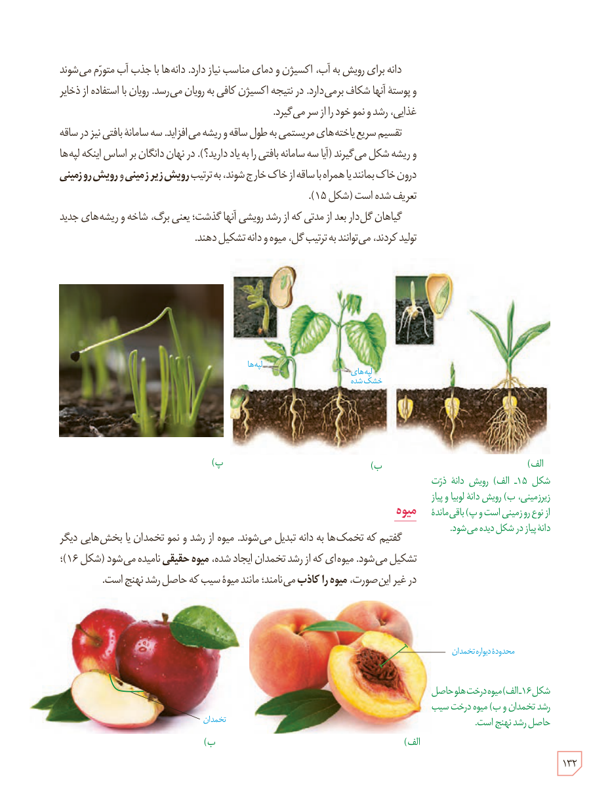

دانه برای رویش به آب، اکسیژن و دمای مناسب نیاز دارد. دانه‌ها با جذب آب متورم می‌شوند و پوستۀ آنها شکاف برمی‌دارد. در نتیجه اکسیژن کافی به رویان می‌رسد. رویان با استفاده از ذخایر غذایی، رشد و نمو خود را از سر می‌گیرد.

تقسیم سریع یاخته‌های مریستمی به طول ساقه و ریشه می‌افزاید. سه سامانۀ بافتی نیز در ساقه و ریشه شکل می‌گیرند (آیا سه سامانۀ بافتی را به یاد دارید؟). در نهان‌دانگان بر اساس اینکه لپه‌ها درون خاک بمانند یا همراه با ساقه از خاک خارج شوند، به ترتیب **رویش زیرزمینی** و **رویش روزمینی** تعریف شده است (شکل ۱۵).

گیاهان گل‌دار بعد از مدتی که از رشد رویشی آنها گذشت؛ یعنی برگ، شاخه و ریشه‌های جدید تولید کردند، می‌توانند به ترتیب گل، میوه و دانه تشکیل دهند.

شکل ۱۵ـ الف) رویش دانۀ ذرت زیرزمینی، ب) رویش دانۀ لوبیا و پیاز از نوع روزمینی است و پ) باقی‌ماندۀ دانۀ پیاز در شکل دیده می‌شود. برچسب‌ها: لپه‌ها، لپه‌های خشک‌شده.

## میوه

گفتیم که تخمک‌ها به دانه تبدیل می‌شوند. میوه از رشد و نمو تخمدان یا بخش‌هایی دیگر تشکیل می‌شود. میوه‌ای که از رشد تخمدان ایجاد شده، **میوۀ حقیقی** نامیده می‌شود (شکل ۱۶)؛ در غیر این صورت، **میوه را کاذب** می‌نامند؛ مانند میوۀ سیب که حاصل رشد نهنج است.

شکل ۱۶ـ الف) میوۀ درخت هلو حاصل رشد تخمدان و ب) میوۀ درخت سیب حاصل رشد نهنج است. برچسب‌ها: محدودۀ دیوارۀ تخمدان، تخمدان.

۱۳۲

