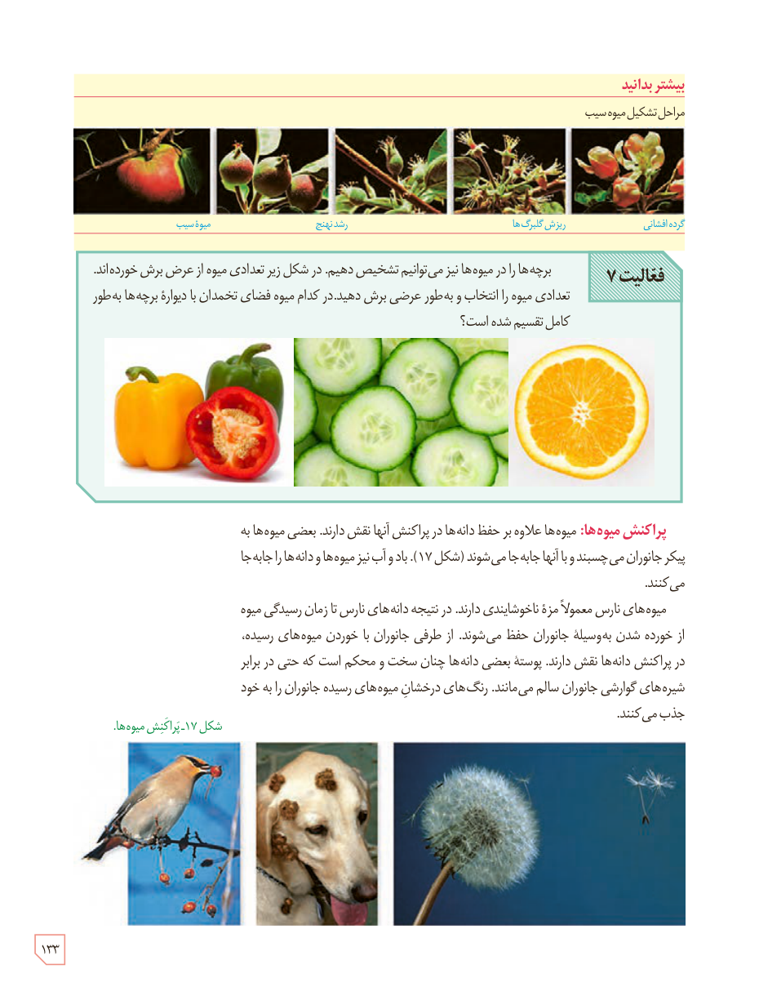

### بیشتر بدانید

مراحل تشکیل میوۀ سیب: گرده‌افشانی، ریزش گلبرگ‌ها، رشد نهنج، میوۀ سیب.

**فعالیت ۷**

برچه‌ها را در میوه‌ها نیز می‌توانیم تشخیص دهیم. در شکل زیر تعدادی میوه از عرض برش خورده‌اند. تعدادی میوه را انتخاب و به‌طور عرضی برش دهید. در کدام میوه فضای تخمدان با دیوارۀ برچه‌ها به‌طور کامل تقسیم شده است؟

**پراکنش میوه‌ها:** میوه‌ها علاوه بر حفظ دانه‌ها در پراکنش آنها نقش دارند. بعضی میوه‌ها به پیکر جانوران می‌چسبند و با آنها جابه‌جا می‌شوند (شکل ۱۷). باد و آب نیز میوه‌ها و دانه‌ها را جابه‌جا می‌کنند.

میوه‌های نارس معمولاً مزۀ ناخوشایندی دارند. در نتیجه دانه‌های نارس تا زمان رسیدگی میوه از خورده شدن به‌وسیلۀ جانوران حفظ می‌شوند. از طرفی جانوران با خوردن میوه‌های رسیده، در پراکنش دانه‌ها نقش دارند. پوستۀ بعضی دانه‌ها چنان سخت و محکم است که حتی در برابر شیره‌های گوارشی جانوران سالم می‌مانند. رنگ‌های درخشان میوه‌های رسیده جانوران را به خود جذب می‌کنند.

شکل ۱۷ـ پراکنش میوه‌ها.

۱۳۳

