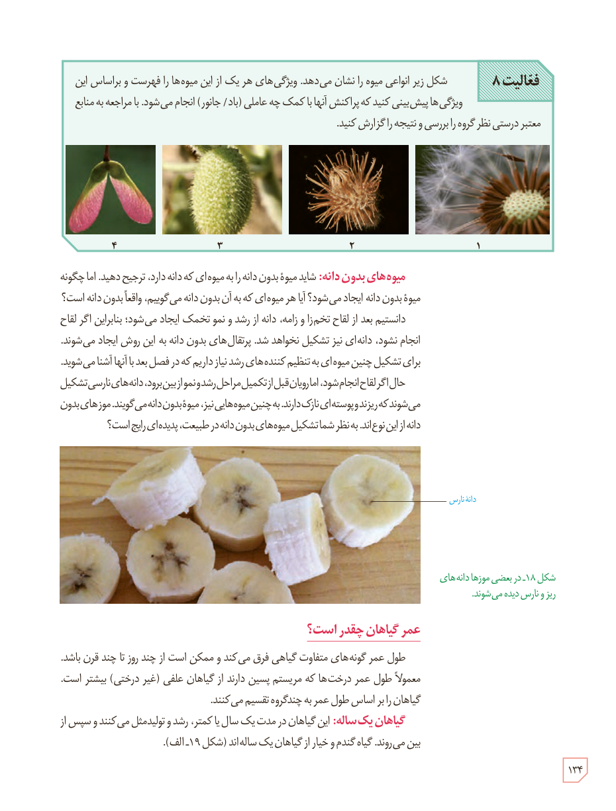

**فعالیت ۸**

شکل زیر انواعی میوه را نشان می‌دهد. ویژگی‌های هر یک از این میوه‌ها را فهرست و براساس این ویژگی‌ها پیش‌بینی کنید که پراکنش آنها با کمک چه عاملی (باد/ جانور) انجام می‌شود. با مراجعه به منابع معتبر درستی نظر گروه را بررسی و نتیجه را گزارش کنید.

**میوه‌های بدون دانه:** شاید میوۀ بدون دانه را به میوه‌ای که دانه دارد، ترجیح دهید. اما چگونه میوۀ بدون دانه ایجاد می‌شود؟ آیا هر میوه‌ای که به آن بدون دانه می‌گوییم، واقعاً بدون دانه است؟

دانستیم بعد از لقاح تخم‌زا و زامه، دانه از رشد و نمو تخمک ایجاد می‌شود؛ بنابراین اگر لقاح انجام نشود، دانه‌ای نیز تشکیل نخواهد شد. پرتقال‌های بدون دانه به این روش ایجاد می‌شوند. برای تشکیل چنین میوه‌ای به تنظیم‌کننده‌های رشد نیاز داریم که در فصل بعد با آنها آشنا می‌شوید.

حال اگر لقاح انجام شود، اما رویان قبل از تکمیل مراحل رشد و نمو از بین برود، دانه‌های نارسی تشکیل می‌شوند که ریزند و پوسته‌ای نازک دارند. به چنین میوه‌هایی نیز، میوۀ بدون دانه می‌گویند. موزهای بدون دانه از این نوع‌اند. به نظر شما تشکیل میوه‌های بدون دانه در طبیعت، پدیده‌ای رایج است؟

شکل ۱۸ـ در بعضی موزها دانه‌های ریز و نارس دیده می‌شوند. برچسب: دانۀ نارس.

## عمر گیاهان چقدر است؟

طول عمر گونه‌های متفاوت گیاهی فرق می‌کند و ممکن است از چند روز تا چند قرن باشد. معمولاً طول عمر درخت‌ها که مریستم پسین دارند از گیاهان علفی (غیر درختی) بیشتر است. گیاهان را بر اساس طول عمر به چند گروه تقسیم می‌کنند.

**گیاهان یک‌ساله:** این گیاهان در مدت یک سال یا کمتر، رشد و تولیدمثل می‌کنند و سپس از بین می‌روند. گیاه گندم و خیار از گیاهان یک‌ساله‌اند (شکل ۱۹ـ الف).

۱۳۴

