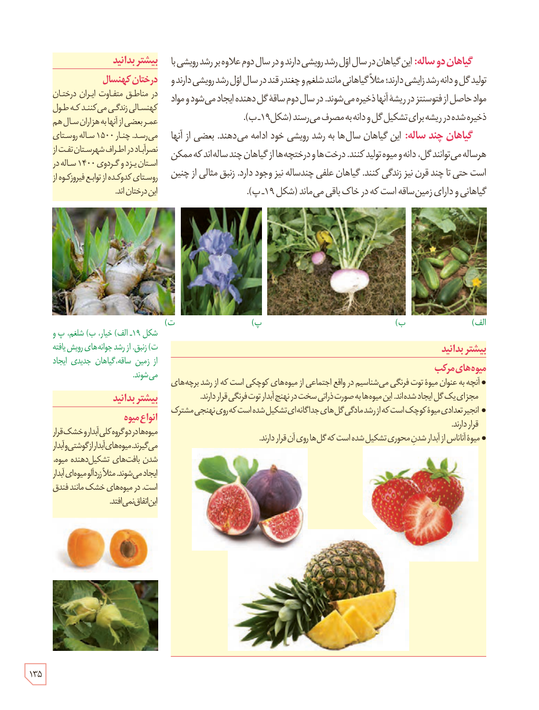

**گیاهان دو ساله:** این گیاهان در سال اول رشد رویشی دارند و در سال دوم علاوه بر رشد رویشی با تولید گل و دانه رشد زایشی دارند؛ مثلاً گیاهانی مانند شلغم و چغندر قند در سال اول رشد رویشی دارند و مواد حاصل از فتوسنتز در ریشۀ آنها ذخیره می‌شوند. در سال دوم ساقۀ گل‌دهنده ایجاد می‌شود و مواد ذخیره شده در ریشه برای تشکیل گل و دانه به مصرف می‌رسند (شکل ۱۹ـ ب).

**گیاهان چند ساله:** این گیاهان سال‌ها به رشد رویشی خود ادامه می‌دهند. بعضی از آنها هر ساله می‌توانند گل، دانه و میوه تولید کنند. درخت‌ها و درختچه‌ها از گیاهان چندساله‌اند که ممکن است حتی تا چند قرن نیز زندگی کنند. گیاهان علفی چندساله نیز وجود دارند. زنبق مثالی از چنین گیاهانی و دارای زمین‌ساقه است که در خاک باقی می‌ماند (شکل ۱۹ـ پ).

شکل ۱۹ـ الف) خیار، ب) شلغم، پ و ت) زنبق. از رشد جوانه‌های رویش‌یافته از زمین‌ساقه، گیاهان جدیدی ایجاد می‌شوند.

### بیشتر بدانید: درختان کهنسال

در مناطق متفاوت ایران درختان کهنسالی زندگی می‌کنند که طول عمر بعضی از آنها به هزاران سال هم می‌رسد. چنار ۱۵۰۰ سالۀ روستای نصرت‌آباد در اطراف شهرستان تفت از استان یزد و گردوی ۱۴۰۰ ساله در روستای گدوکده از توابع فیروزکوه از این درختان‌اند.

### بیشتر بدانید: انواع میوه

میوه‌ها در دو گروه کلی آبدار و خشک قرار می‌گیرند. میوه‌های آبدار از گوشتی و آبدار شدن بافت‌های تشکیل‌دهندۀ میوه، ایجاد می‌شوند. مثلاً زردآلو میوه‌ای آبدار است. در میوه‌های خشک مانند فندق این اتفاق نمی‌افتد.

### بیشتر بدانید: میوه‌های مرکب

- آنچه به عنوان میوۀ توت‌فرنگی می‌شناسیم در واقع اجتماعی از میوه‌های کوچکی است که از رشد برچه‌های مجزای یک گل ایجاد شده‌اند. این میوه‌ها به صورت دانه‌ای سخت در نهنج آبدار توت‌فرنگی قرار دارند.
- انجیر تعدادی میوۀ کوچک است که از رشد مادگی گل‌های جداگانه‌ای تشکیل شده است که روی نهنجی مشترک قرار دارند.
- میوۀ آناناس از آبدار شدن محوری تشکیل شده است که گل‌ها روی آن قرار دارند.

۱۳۵

